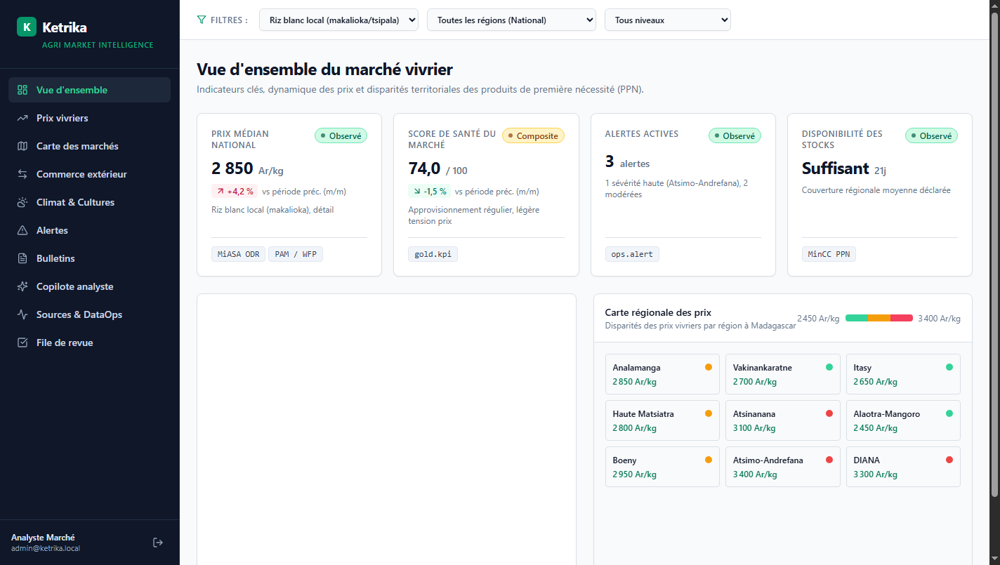
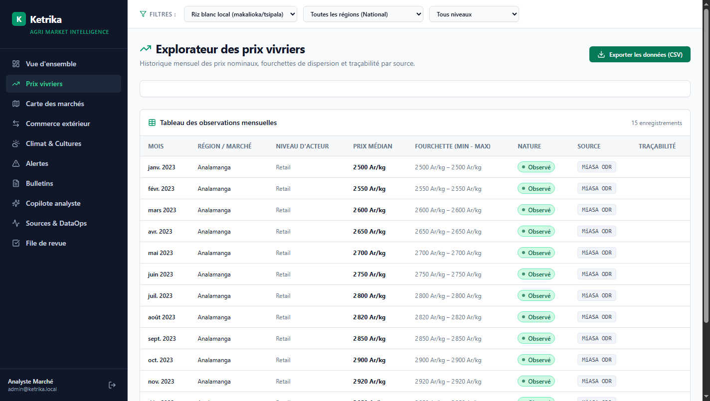
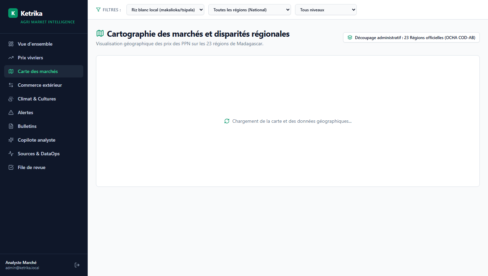
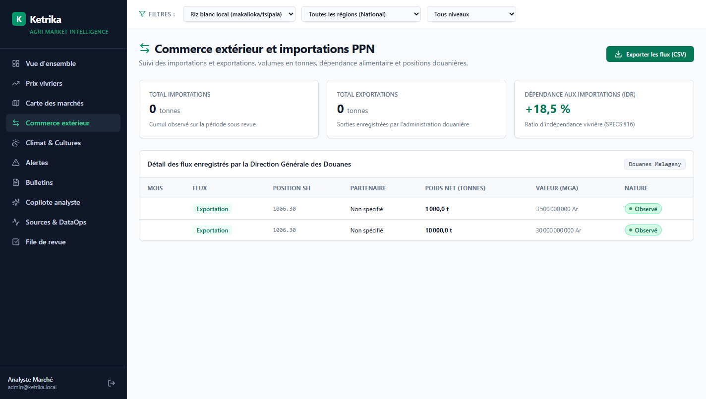
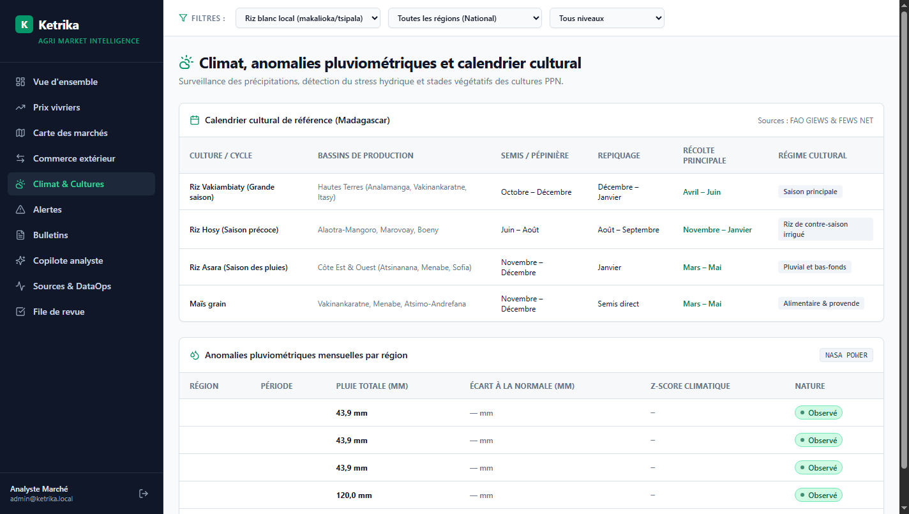
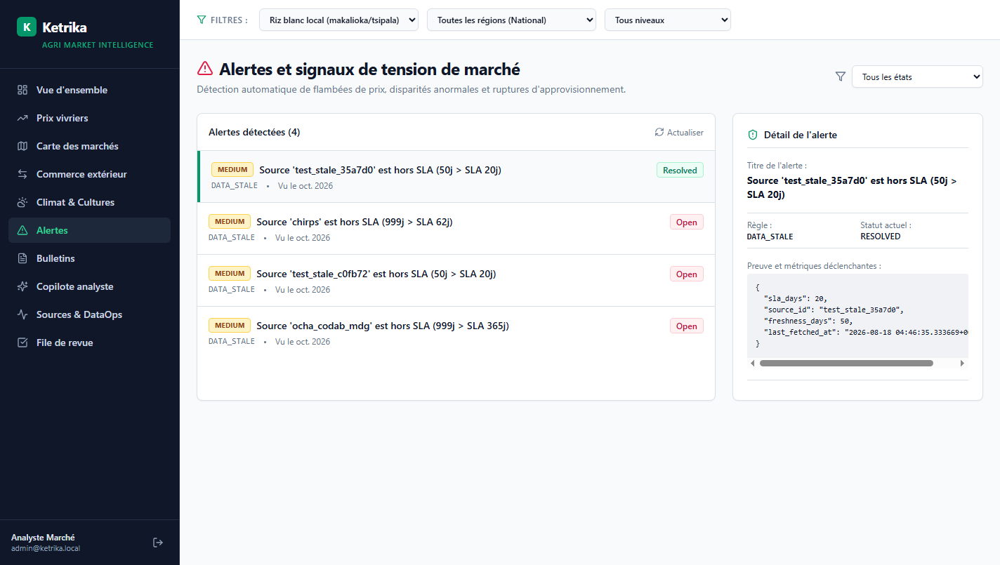
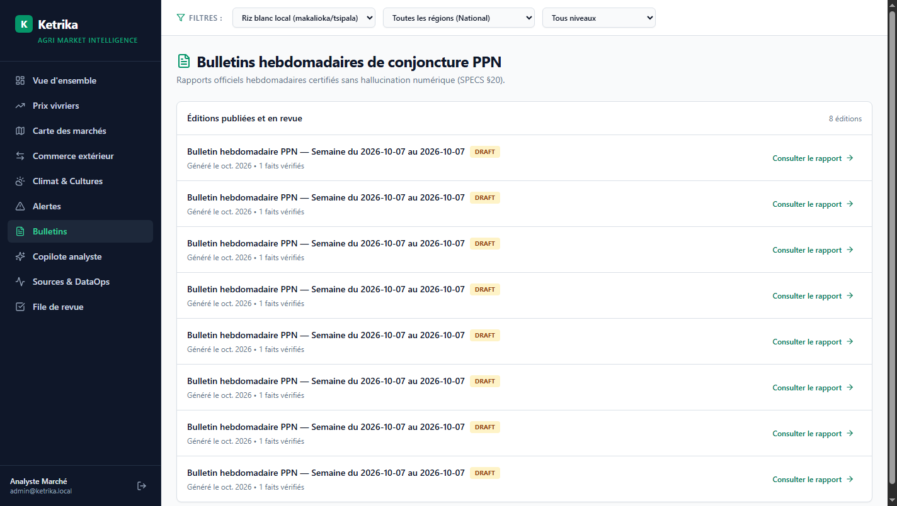
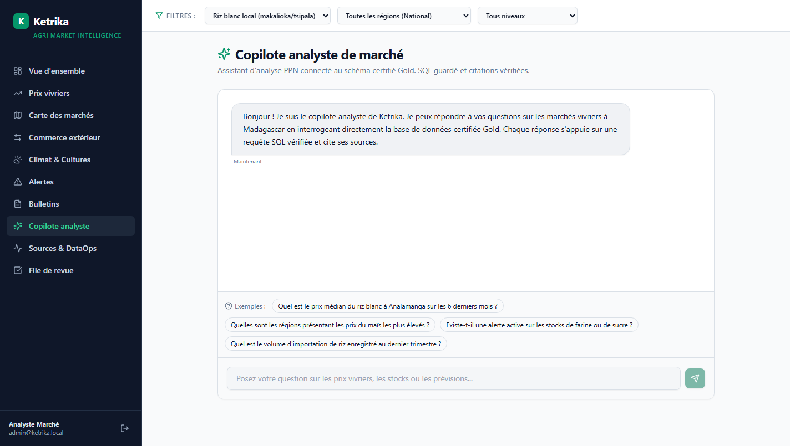

# Ketrika Agri Market Intelligence

[](https://github.com/ketrika/ai-agent/actions/workflows/ci.yml)
[](https://github.com/ketrika/ai-agent)
[](LICENSE)
[](https://python.org)
[](https://nextjs.org)
[](https://postgis.net)

Plateforme souveraine de veille de marché et d'intelligence économique sur les **Produits de Première Nécessité (PPN) et denrées vivrières à Madagascar** (riz blanc local Vary Gasy, Makalioka, Tsipala, riz importé, maïs, manioc, huile alimentaire, sucre, farine de blé, légumineuses) avec traçabilité et **provenance vérifiable à 100 %**.

État au 2026-10-09 : requalification R0–R6 en cours. Les capacités décrites ci-dessous sont des objectifs et des livrables historiques, pas une certification actuelle de collecte live, de performance prédictive, de déploiement ou d'usage humain. Consulter le plan R et PROGRESS pour les preuves courantes.

---

## 1. Vue d'ensemble et proposition de valeur

Ketrika Agri Market Intelligence résout le problème critique de l'opacité et de la dispersion des données de marché agricole à Madagascar. La plateforme collecte, vérifie, normalise et modélise les données issues d'organismes publics et officiels, en garantissant qu'aucun chiffre n'entre dans les tableaux de bord ou les rapports sans une preuve mécanique directe vers le document source originel.

```
+-----------------------------------------------------------------------------------+
|                               SOURCES DE DONNÉES                                  |
|   MiASA/ODR  *  Banque Mondiale  *  WFP HDX  *  MinCC  *  Douanes  *  NASA POWER  |
+-----------------------------------------------------------------------------------+
                                          |
                                          v
+-----------------------------------------------------------------------------------+
| BRONZE STORAGE (S3/MinIO/R2) : Objets immuables adressés par hachage SHA-256     |
+-----------------------------------------------------------------------------------+
                                          |
                                          v
+-----------------------------------------------------------------------------------+
| SILVER STORE (PostGIS) : Ingestion append-only, normalisation, auditabilité totale|
+-----------------------------------------------------------------------------------+
                                          |
                                          v
+-----------------------------------------------------------------------------------+
| GOLD STORE : Vues matérialisées, indicateurs (MHS), détection d'anomalies, ML     |
+-----------------------------------------------------------------------------------+
                                          |
        +---------------------------------+---------------------------------+
        v                                 v                                 v
+------------------+             +------------------+             +------------------+
| API REST FastAPI |             | Dashboard Web    |             | Copilote SQL &   |
| (Endpoints v1)   |             | (Next.js 14 UI)  |             | Bulletins Hebdo  |
+------------------+             +------------------+             +------------------+
```

### Principes d'ingénierie non négociables
1. **Provenance totale :** chaque observation en base fait référence à un `source_record`, qui pointe vers un objet Bronze immuable avec preuve (page + extrait ou ligne exacte).
2. **Bronze immuable :** aucun objet Bronze ne peut être altéré ou supprimé (scellé cryptographiquement par SHA-256).
3. **Ajout seul (Append-Only) :** aucune mise à jour destructive. Les révisions de données créent de nouvelles lignes portant la référence `superseded_by`.
4. **Rejouabilité intégrale :** toute la base Silver et Gold peut être reconstruite à tout moment depuis le Bronze via `./scripts/dev.ps1 rebuild` en mode 100% hors ligne (`HTTP_OFFLINE=1`).
5. **Zéro chiffre LLM non vérifié :** les synthèses, bulletins et réponses du copilote n'écrivent jamais un chiffre non validé mécaniquement par requête SQL ou fait calculé.

---

## 2. Galerie de l'interface utilisateur

| Tableau de bord synthétique | Analyse des prix vivriers |
|---|---|
|  |  |

| Cartographie régionale choroplèthe | Commerce extérieur & Importations |
|---|---|
|  |  |

| Météo agricole & Précipitations | Cockpit de surveillance des alertes |
|---|---|
|  |  |

| Générateur de bulletins certifiés | Copilote analyste NL2SQL sécurisé |
|---|---|
|  |  |

---

## 3. Architecture technique

- **Backend applicatif :** Python 3.12, FastAPI, SQLAlchemy 2 (async), Pydantic v2, Uvicorn.
- **Orchestration des pipelines :** [Dagster](https://dagster.io) (DAGs d'actifs partitionnés, sensors de pannes, backfills réentrants).
- **Base de données relationnelle & spatiale :** PostgreSQL 17 + extension PostGIS 3.5. Schémas isolés : `meta`, `ref`, `obs`, `ml`, `ops`, `gold`, `dq`, `auth`.
- **Modélisation & Séries chronologiques :** LightGBM, StatsForecast (AutoARIMA, Holt-Winters, SeasonalNaive), Pandera pour la validation de schémas de données.
- **Frontend web :** Next.js 14 (App Router), React 18, TypeScript, Tailwind CSS, composants shadcn/ui, Apache ECharts, MapLibre GL.
- **Reverse Proxy & TLS :** Caddy 2 (certificats HTTPS automatiques Let's Encrypt, compression zstd/gzip, headers HSTS).
- **Sécurité :** Rôle base de données restreint `copilot_ro` confiné en lecture seule sur `gold.*`, protection contre les injections SQL par analyseur syntaxique AST `sqlglot`.

---

## 4. Démarrage rapide (Développement local)

### Prérequis
- **Système d'exploitation :** Windows (PowerShell), Linux ou macOS
- **Moteurs :** Docker Desktop ou Docker Engine avec Docker Compose v2+
- Ports par défaut (isolés sans conflits) :
  - Web UI : `http://localhost:3005`
  - API Backend : `http://localhost:8090/v1/health` (Swagger sur `/docs`)
  - Dagster UI : `http://localhost:3010`
  - Mailpit (Webmail de test) : `http://localhost:8025`
  - MinIO Console : `http://localhost:9101` (API sur `9100`)
  - Base de données PostGIS : `localhost:5434`

### Commandes de démarrage

Sous Windows PowerShell :
```powershell
# 1. Cloner le dépôt
git clone https://github.com/ketrika/ai-agent.git
cd "ai-agent"

# 2. Démarrer l'ensemble des services conteneurisés
./scripts/dev.ps1 up

# 3. Vérifier la santé du système
curl http://localhost:8090/v1/health

# 4. Lancer la suite de contrôles qualité (lint, types, tests backend et web)
./scripts/dev.ps1 check
```

Sous Linux / macOS :
```bash
./scripts/dev.sh up
./scripts/dev.sh check
```

Identifiants de démonstration pré-configurés :
- **Email :** `admin@ketrika.local`
- **Mot de passe :** `change-me`

---

## 5. Guide des commandes (`scripts/dev.ps1` / `scripts/dev.sh`)

Le runner `./scripts/dev.ps1` (ou `./scripts/dev.sh`) constitue le point d'entrée unique de gestion :

| Commande | Description |
|---|---|
| `./scripts/dev.ps1 up` | Démarre la stack Docker complète et attend que les healthchecks soient sains. |
| `./scripts/dev.ps1 down` | Arrête l'ensemble des conteneurs sans détruire les données. |
| `./scripts/dev.ps1 reset` | Refusé : supprimer les volumes violerait l'immutabilité du Bronze. |
| `./scripts/dev.ps1 check` | Contrôles complets dans le profil isolé : lint, format, types, tests backend/intégration, couverture par package, lint/types/tests/build web. |
| `./scripts/dev.ps1 test` | Tests backend dans la base et le stockage de qualification dédiés ; aucun effectif historique n'est une preuve actuelle. |
| `./scripts/dev.ps1 qa-isolated prepare` | Initialise les ressources dédiées sans supprimer de volume ni modifier la stack active. |
| `./scripts/dev.ps1 rebuild` | Purge les schémas Silver/Gold et rejoue l'intégralité des pipelines depuis le Bronze en **mode 100% hors-ligne**. |
| `./scripts/dev.ps1 backfill <source_id\|all>` | Lance les backfills d'ingestion Dagster pour une source ou pour toutes. |
| `./scripts/dev.ps1 bulletin` | Génère un projet de bulletin hebdomadaire PDF certifié et vérifie l'exactitude des chiffres. |
| `./scripts/dev.ps1 backup` | Génère un dump binaire scellé de la base PostGIS (`deploy/backup.sh`). |
| `./scripts/dev.ps1 restore [fichier]` | Restaure la base à partir d'une sauvegarde et rafraîchit les vues Gold (`deploy/restore.sh`). |
| `./scripts/dev.ps1 demo` | Refuse le runner historique synthétique (ADR-009) sans mutation ; qualification mesurée à livrer en R0.7. |

---

### Qualification du programme R

Le plan courant est `docs/plan/MARKET_INTELLIGENCE_EXECUTION_PLAN.md` ; les statuts canoniques sont dans `docs/plan/PROGRESS.md`. Les tags et résultats T sont historiques, sans requalification implicite.

`check` utilise exclusivement `docker-compose.qualification.yml` et les entrées publiques `scripts/qualification.env`, jamais `.env`. Le projet `ketrika-qualification` a sa propre base `ketrika_qualification`, son bucket `ketrika-qa-bronze`, ses volumes nommés et un réseau interne sans port publié. Les sources hôte sont montées en lecture seule ; backend et front sont copiés dans leurs volumes dédiés pour éviter les accès répétés au système de fichiers Windows pendant les contrôles. Le backend ne copie ni `.env` ni dépendances hôte. Les threads numériques de test sont bornés à 1, les caches restent dans les volumes dédiés ; aucun modèle/test n'est retiré. Les identifiants de ce profil sont des fixtures publiques et ne doivent pas être utilisés en production.

Les gardes refusent les destinations actives, les ressources Docker étrangères, les seeds synthétiques sur une session non dédiée et les skips sélectionnés dans la suite de qualification. Aucun `down -v`, reset ou nettoyage du Bronze n'est nécessaire. Les tests hors réseau qualifient le logiciel, pas une source live, un modèle économique ni un usage humain. `qa` et `qualify` restent refusés tant que leur moteur n'est pas implémenté et qualifié.

Voir [le runbook de qualification](docs/runbooks/qualification.md) pour séparer tests, historique contaminé et archives authentiques. L'inventaire R0.2 est en lecture seule ; aucune purge n'est autorisée ou exécutée.

## 6. Déploiement en production (VPS Ubuntu 24.04)

La plateforme est livrée prête à être déployée en production sur un serveur VPS autonome :

1. Exécuter le script de bootstrap système sur un VPS vierge :
   ```bash
   ./deploy/bootstrap-vps.sh
   ```
2. Renseigner les variables de production dans `.env` (certificats Cloudflare R2, mots de passe forts, clés LLM).
3. Lancer la composition durcie de production :
   ```bash
   docker compose -f docker-compose.prod.yml up -d
   ```
Consultez le runbook opérationnel détaillé : [`docs/runbooks/deploy.md`](docs/runbooks/deploy.md).

---

## 7. Documentation et runbooks opérationnels

- **Constitution & Règles de conduite de l'agent :** [`AGENTS.md`](AGENTS.md)
- **Spécifications techniques et contrats :** [`docs/plan/SPECS.md`](docs/plan/SPECS.md)
- **Registre d'exécution et journal de bord :** [`docs/plan/PROGRESS.md`](docs/plan/PROGRESS.md)
- **Registre des décisions d'architecture (ADR) :** [`docs/plan/DECISIONS.md`](docs/plan/DECISIONS.md)
- **Rapport de revue de sécurité :** [`docs/SECURITY_REVIEW.md`](docs/SECURITY_REVIEW.md)
- **Runbooks d'exploitation :**
  - [Déploiement VPS](docs/runbooks/deploy.md)
  - [Sauvegarde et restauration](docs/runbooks/restore.md)
  - [Rotation des secrets](docs/runbooks/rotate-secrets.md)
  - [Ajout d'un nouveau connecteur](docs/runbooks/add-connector.md)
- **Fiches descriptives des sources de données :**
  - [Observatoire du Riz (MiASA ODR)](docs/sources/miasa_odr.md)
  - [WFP HDX Madagascar](docs/sources/wfp_hdx_mdg.md)
  - [Banque Mondiale RTFP](docs/sources/wb_rtfp_mdg.md)
  - [FAOSTAT Madagascar](docs/sources/faostat.md)
  - [INSTAT NIPC Inflation](docs/sources/instat_nipc.md)
  - [MinCC Stocks & Prix PPN](docs/sources/mincc_ppn.md)
  - [Douanes Malagasy Statistiques Commerce](docs/sources/douanes_stats.md)
  - [NASA POWER Climat](docs/sources/nasa_power.md)
  - [CHIRPS Précipitations](docs/sources/chirps.md)
  - [OCHA COD-AB Découpage administratif](docs/sources/ocha_codab_mdg.md)
- **Modèles de demande de partenariat institutionnel (non envoyés) :**
  - [Partenariat MiASA / ODR](docs/outreach/miasa_odr_outreach.md)
  - [Partenariat MinCC](docs/outreach/mincc_outreach.md)
  - [Partenariat INSTAT](docs/outreach/instat_outreach.md)
  - [Partenariat Tantsah](docs/outreach/tantsah_outreach.md)

---

## 8. Gouvernance et éthique

Ketrika adhère à des règles déontologiques strictes :
- **Respect des éditeurs et robots :** respect total des fichiers `robots.txt`, cadence maximale de 0,2 req/sec par domaine, User-Agent officiel et identifiable.
- **Politique « permission d'abord » :** aucune collecte de places de marché privées sans accord formel explicite (ADR-002, Gate H4).
- **Protection des données personnelles :** zéro donnée personnelle de commerçants ou consommateurs collectée.
- **Transparence algorithmique :** les prévisions et imputations sont explicitement estampillées et dissociées des valeurs physiquement observées.
