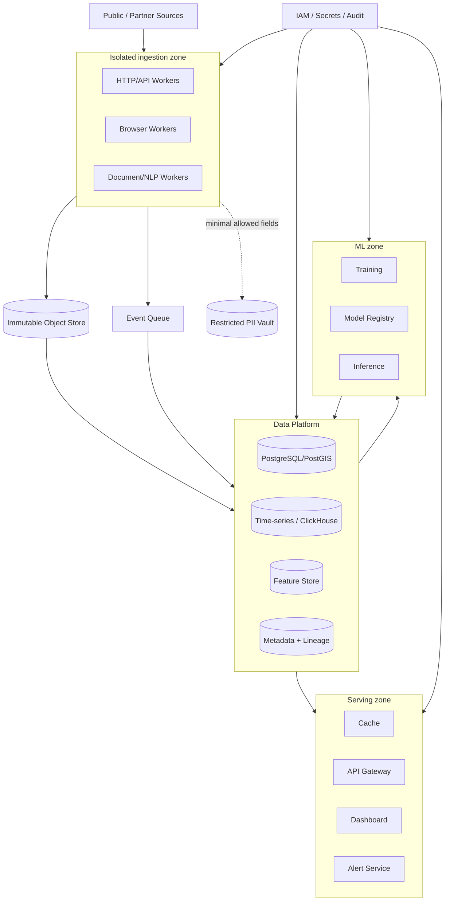
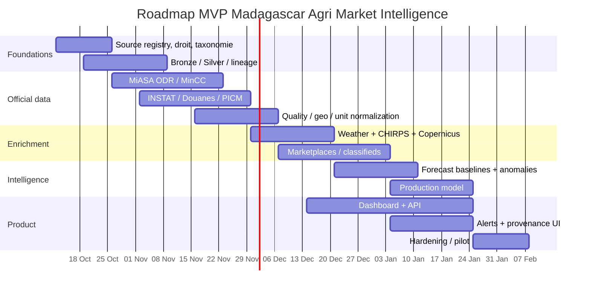

# Système agentique de collecte et d’agrégation de données agricoles et de marché à Madagascar

## Synthèse exécutive

Le système à construire ne devrait pas être conçu comme « un scraper qui alimente un dashboard », mais comme une **plateforme de market intelligence à provenance vérifiable**, composée de quatre couches distinctes : acquisition multi-source, normalisation sémantique et géographique, intelligence statistique/ML, puis diffusion par dashboard, alertes et API.

Le potentiel de données publiques est réel. Madagascar dispose déjà de plusieurs actifs particulièrement intéressants : les bulletins mensuels de l’Observatoire du Riz du ministère chargé de l’Agriculture contiennent des prix producteurs/grossistes/détaillants en Ar/kg, distinguant paddy, riz blanc local et importé, avec détail régional et souvent par district ; le ministère du Commerce publie des relevés de prix et de stocks par région ; l’INSTAT diffuse le NIPC et des fichiers Excel historiques ; les Douanes publient des flux d’import/export en valeur et poids ; Météo Madagascar diffuse des prévisions saisonnières cartographiées ; et le portail commercial du gouvernement fournit codes SH, procédures et événements réglementaires. citeturn19view0turn22search0turn22search1turn22search2turn20view1turn22search3

L’ODR est particulièrement structurant. Son bulletin de mai 2025 indique explicitement que les informations sont recueillies mensuellement ; il distingue les prix aux producteurs, grossistes et détaillants, les variétés locales les plus vendues et les observations par région/district. Il documente également les valeurs « ND » et « NA », ce qui est extrêmement utile pour construire une ingestion sans transformer l’absence d’observation en zéro. citeturn19view0 La page officielle des bulletins expose en outre plusieurs éditions successives et un flux RSS du site ministériel. citeturn18search5turn18search6

À cela peuvent s’ajouter des sources internationales à forte valeur analytique : FAOSTAT dispose depuis 2026 d’un portail API permettant notamment JSON/CSV et accès aux métadonnées ; le jeu « Real Time Food Prices » de la Banque mondiale couvre actuellement Madagascar sur 469 marchés de 2007 à août 2026 et est recalculé chaque semaine ; WFP/HDX propose les historiques de prix alimentaires en CSV ; FEWS NET et GIEWS apportent analyses de récoltes, prix et sécurité alimentaire ; NASA POWER, CHIRPS et Copernicus apportent météo et télédétection programmatiquement. citeturn24search0turn24search1turn25search0turn25search1turn18search7turn23search1turn23search0turn23search19

Le Web marchand peut compléter ces données par des **signaux haute fréquence**, mais il ne doit pas devenir la vérité de référence. Tantsah, CoinAfrique et EspaceAgro exposent des annonces agricoles ou alimentaires, des localisations, des vendeurs et parfois des prix ; ce sont des observations d’offre affichée, et non nécessairement des ventes réalisées. Pour Tantsah, les CGU consultées ne constituent pas une autorisation explicite de réutilisation automatisée à grande échelle. **I cannot confirm this** pour l’existence d’une API publique ou d’un droit général de scraping sur Tantsah, CoinAfrique ou EspaceAgro ; il faudrait donc effectuer un contrôle automatisé des CGU/robots et rechercher des accords de flux lorsque le volume devient commercialement significatif. citeturn14view0turn15view0turn16search1turn16search2turn3search5

La principale limite conceptuelle est la suivante : **le Web public permet de mesurer beaucoup mieux l’offre et les prix que la demande ou la consommation réelles**. Le nombre d’annonces, les recherches, contacts WhatsApp ou publications sociales sont des proxys. Pour transformer le dashboard en véritable outil de prévision de demande, il faudra idéalement obtenir des données transactionnelles, des demandes d’acheteurs, des recherches internes, des contacts vendeurs ou des données de coopératives et distributeurs. La consommation, elle, doit être estimée à partir de statistiques ménages/bilans alimentaires et non déduite des annonces.

Je recommande donc une hiérarchie explicite :

| Niveau | Usage | Principe |
|---|---|---|
| **P0 — vérité de référence** | prix officiels, production, inflation, commerce extérieur, météo nationale, réglementation | MiASA/ODR, INSTAT, MinCC, Douanes, Météo Madagascar, PICM |
| **P1 — enrichissement quantitatif** | historique, météo, télédétection, sécurité alimentaire, commerce international | FAO, Banque mondiale, WFP, FEWS NET, UN Comtrade, NASA/CHIRPS/Copernicus |
| **P2 — signaux de marché** | offre instantanée, prix affichés, nouveaux produits, vendeurs | Tantsah, CoinAfrique, EspaceAgro, autres catalogues |
| **P3 — signaux faibles** | sentiment, événements, rumeurs, pénuries émergentes | presse et contenu social public et licitement accessible |

Le **MVP recommandé est réalisable en environ 18 semaines**, avec une équipe moyenne de 4,5–6 ETP techniques et l’appui partiel d’experts agriculture/juridique : \(4,5–6 × 18 = 81–108\) personnes-semaines techniques, auxquelles j’ajouterais environ 10–15 personnes-semaines de travail métier/juridique, soit **environ 90–125 personnes-semaines**. Il doit commencer par les sources P0, l’historisation et la taxonomie ; le scraping massif de marketplaces et les modèles ML complexes viennent seulement ensuite.

**Estimation budgétaire d’infrastructure, hors salaires, licences commerciales et acquisition de données :**

- faible : **0,3–1,2 kUSD/mois** ;
- intermédiaire : **2–7,1 kUSD/mois** ;
- haute volumétrie/HA/social/télédétection intensive : **10,5–45 kUSD/mois**.

Ces fourchettes sont des **estimations d’architecture**, et non des devis fournisseurs ; leur calcul détaillé apparaît plus bas.

Enfin, l’objectif « toutes les données disponibles en ligne » doit être interprété comme **toutes les données publiques ou contractuellement accessibles que le système est autorisé à collecter et dont la provenance peut être auditée**. Il n’est ni techniquement ni juridiquement possible de garantir l’exhaustivité du Web dynamique, des groupes privés, des messageries ou des plateformes fermées.

## Objectifs, indicateurs et définition de la vérité marché

Le dashboard devrait séparer trois catégories d’indicateurs : les **mesures observées**, les **indices composites internes** et les **prévisions**. Cette séparation est importante : un prix ODR observé ne doit jamais être présenté de la même manière qu’une estimation ML de demande.

### KPI de market intelligence recommandés

| KPI | Définition proposée | Calcul / données nécessaires | Fréquence |
|---|---|---|---|
| **Market Health Score** | indicateur synthétique 0–100 | disponibilité, accessibilité des prix, stabilité, profondeur d’offre, adéquation offre/demande, risque climatique/logistique | quotidien/hebdo |
| **Prix marché** | prix médian et distribution | produit × qualité × unité × canal × marché × date | intraday à mensuel |
| **Inflation produit** | variation du prix normalisé | \(P_t/P_{t-k}-1\), k = 7 j, 30 j, 12 mois | quotidien |
| **Volatilité** | instabilité robuste | MAD/median ou volatilité des log-prix | hebdo |
| **Trending products** | accélération d’intérêt/offre | annonces, recherches, demandes, mentions, variation prix/volume | quotidien |
| **Demand Pressure** | tension demande/offre | demandes et contacts / offre disponible, corrigés des effets saisonniers | quotidien |
| **Availability Index** | disponibilité physique approximative | stocks officiels + vendeurs actifs + annonces + volumes disponibles | quotidien/hebdo |
| **Consumption Nowcast** | consommation estimée | enquêtes/bilans alimentaires + population + prix + pouvoir d’achat + disponibilité | mensuel |
| **Best Deal Score** | prix ajusté qualité/logistique vs prix attendu | prix livré normalisé comparé au fair value model | intraday |
| **Production Forecast** | récolte attendue | surface × rendement prédit, météo + végétation + calendrier cultural | décade/mensuel |
| **Import Dependency** | dépendance aux approvisionnements extérieurs | importations / disponibilité totale estimée | mensuel |
| **Alert Risk** | probabilité/gravité d’un événement | anomalies de prix, stocks, météo, réglementation, news | quasi temps réel |

Le **Market Health Score** ne serait pas une statistique officielle mais un indicateur propriétaire. Une première formule explicable pourrait être :

\[
H = 0.25A_v + 0.20A_f + 0.20S_p + 0.15S_a + 0.10D_m + 0.10R_c
\]

où \(A_v\) = disponibilité, \(A_f\) = accessibilité/affordability, \(S_p\) = stabilité des prix, \(S_a\) = adéquation offre/demande, \(D_m\) = profondeur du marché, \(R_c\) = résilience climatique/logistique. Chaque composant est ramené sur 0–100. **Recommandation :** conserver et exposer les six composantes au lieu de ne montrer que le score agrégé afin d’éviter une « boîte noire ».

Pour les tendances, une première fonction pourrait être :

\[
Trend = 0.35z(\Delta listings)+0.25z(\Delta buyer\ intent)+
0.20z(\Delta mentions)+0.20z(\Delta price/volume)
\]

La composante `buyer_intent` ne doit être activée que si des données de demandes, recherches ou contacts sont réellement disponibles. À défaut, le dashboard devrait afficher explicitement **« tendance d’offre / visibilité Web »**, et non « demande ».

Le « meilleur deal » doit comparer des produits homogènes. Une formulation initiale :

\[
DealScore = \frac{\hat P_{fair}-P_{landed}}{\hat P_{fair}}
\times QualityFactor \times ReliabilityFactor
\]

avec :

\[
P_{landed}=P_{achat}+transport+frais+conversion\ d'unité
\]

Un sac de 50 kg annoncé moins cher n’est donc pas automatiquement un meilleur deal qu’un produit classé/premium situé plus près de l’acheteur.

Pour le riz, l’ODR offre déjà le type de segmentation dont cette architecture a besoin : le bulletin de mai 2025 distingue paddy, riz blanc local/importé, producteurs, grossistes et détaillants, et fournit les prix en Ar/kg. citeturn19view0 Cette structure devrait servir de modèle à la couche canonique pour les autres produits.

### KPI de santé du système

Les KPI opérationnels devraient eux-mêmes être visibles dans un « DataOps cockpit ». Les seuils suivants sont des **objectifs proposés**, pas des caractéristiques constatées des sources :

| KPI technique | Cible MVP |
|---|---:|
| provenance/source attachée à chaque observation | **100 %** |
| connecteurs P0 fonctionnels | **≥ 98 %** |
| fraîcheur P95 | **≤ 2 × cadence nominale de la source** |
| records parsés sans erreur | **≥ 99 %** |
| complétude des champs obligatoires | **≥ 95 %** |
| taux résiduel de doublons validés | **< 2 %** |
| changements de schéma détectés avant corruption du Gold | **100 %** |
| forecasts avec version du modèle + date d’entraînement | **100 %** |
| API analytique P95 | **< 1 s** pour les agrégats courants |

Il faut en particulier enregistrer **observation time**, **publication time**, **ingestion time** et **valid time** séparément. Un bulletin publié en mai peut contenir des valeurs d’avril ; une révision douanière ultérieure peut également modifier le passé. Les Douanes précisent justement que les périodes antérieures sont mises à jour au fur et à mesure des liquidations : écraser les anciennes valeurs détruirait donc l’auditabilité. citeturn21view1

## Sources à prioriser, accès et gouvernance juridique

### Comparatif des sources

La colonne « cadence » décrit soit une cadence explicitement annoncée par la source, soit la cadence observable des publications. Lorsque je n’ai pas trouvé d’engagement formel de fréquence ou d’API, je le signale.

| Source / priorité | Données utiles | Accès | Cadence pratique | Risques qualité / juridique |
|---|---|---|---|---|
| **MiASA — ODR, P0** | prix paddy/riz local/importé, producteur/grossiste/détail, régions/districts, variétés | index HTML/RSS + PDF | bulletin explicitement mensuel | PDF semi-structuré, ND/NA, possibles retards/révisions ; source officielle prioritaire. citeturn19view0turn18search5 |
| **Portail SI MiASA, P0** | CGARD géospatial/satellite, Carte Producteur, Metabase, semences, bio, ePhyto | plateformes Web | selon plateforme | plusieurs services sont réservés aux utilisateurs/partenaires autorisés : privilégier partenariat/API plutôt que scraping de comptes. citeturn2search26 |
| **RGA-3 MiASA, P0 futur** | exploitations, surfaces, cultures, élevage, production, géographie | enquête / publication institutionnelle | cycle de recensement | le RGA-3 est en cours en 2026 sur les 24 régions ; le jeu final exploitable n’est pas encore nécessairement publié. citeturn2search11turn2search17turn2search18 |
| **INSTAT NIPC, P0** | CPI, riz, PPN, alimentation, contributions, historiques 2016–2026 | HTML + Excel | publications mensuelles observées | excellent benchmark macro, mais pas un prix transactionnel marché par marché. citeturn22search0turn22search4 |
| **INSTAT Microdata, P0/P1** | enquêtes ménages/agriculture et métadonnées | portail microdata, downloads selon droits | selon enquête | granularité et accès variables ; indispensable à la consommation plutôt qu’au temps réel. citeturn2search3 |
| **Douanes Malagasy, P0** | import/export, poids net, valeur douanière, catégories produit, partenaires | HTML + PDF/fichiers téléchargeables | tableaux mensuels / dashboards | séries révisables ; les Douanes précisent que la statistique officielle du commerce extérieur relève de l’INSTAT et que leurs séries proviennent de leur système. citeturn22search1turn21view1 |
| **MinCC Prix PPN/DRCC, P0** | prix, stocks, disponibilité et observations terrain par région | HTML | par date ; publications régionales fréquentes mais SLA non confirmé | grande valeur locale, mais articles souvent en malgache et semi-structurés. Un rapport d’août 2026 donne par exemple des prix et niveaux de stocks pour Itasy, Vakinankaratra et DIANA. citeturn22search6turn22search2 |
| **PIC Madagascar, P0** | codes SH, procédures import/export, licences, campagnes réglementées | HTML | événements/réglementation | source gouvernementale de référence pour événements commerciaux ; **I cannot confirm this** pour une API publique générale. citeturn22search3turn22search7 |
| **SOC Semences, P1** | variétés, origine, cycle, rendement/zone selon fiches | HTML | irrégulier | données référentielles, pas temps réel ; très utiles pour relier variétés et modèles de rendement. citeturn2search23 |
| **Météo Madagascar, P0/P1** | prévisions saisonnières, pluie/température, cartes régionales | PDF/site | mises à jour saisonnières roulantes observées | extraction géographique parfois nécessaire à partir de cartes/PDF ; conserver la prévision originale et son horizon. citeturn18search0turn18search4turn20view1 |
| **FOFIFA, P1** | variétés, maladies, agronomie, résultats expérimentaux, innovations | HTML/docs | événementiel | excellente couche agronomique mais non conçue comme feed temps réel. Le site est actif en 2026 et publie notamment sur le riz, le café et les centres régionaux. citeturn25search2turn25search6 |
| **CIRAD/Agritrop, P1** | recherche, sols, pratiques, agroécologie, données scientifiques | HTML/publications/datasets | publication scientifique | données souvent spécifiques à une étude ; l’index Madagascar d’Agritrop contient plus d’un millier de publications et des travaux 2026. citeturn25search7turn25search3 |
| **FAOSTAT, P1** | production, rendements, superficies, cheptel, bilans alimentaires, commerce | API + JSON/CSV + bulk | selon domaine/release | forte couverture historique mais nombreuses séries annuelles ; le nouveau portail API 2026 donne accès aux domaines, métadonnées et calendriers de publication. citeturn24search0turn24search3 |
| **FAO GIEWS, P1** | production, prix, risques récolte, sécurité alimentaire | HTML | périodique | analyses/estimations, pas micro-observations brutes. Le brief Madagascar était encore actualisé le 23 septembre 2026. citeturn18search7 |
| **WFP/HDX, P1** | prix par marché/produit + géographie | CSV/HXL | fréquence attendue mensuelle | attention : la ressource a été modifiée en 2026 mais la période de données annoncée s’arrête en février 2023 ; ne pas confondre « fichier récemment mis à jour » et « dernières observations récentes ». citeturn25search0 |
| **Banque mondiale RTFP, P1** | prix mensuels produits/marchés, géolocalisation | API/download | dataset recompilé chaque semaine | 469 marchés, 2007–août 2026, mais les données mêlent mesures et valeurs estimées par ML : garder le flag d’origine/estimation. citeturn24search1turn24search4 |
| **FEWS NET, P1** | prix, récoltes, commerce, sécurité alimentaire, projections | HTML/print | Outlook et updates périodiques | source analytique : conserver fait observé, hypothèse et projection séparément. citeturn25search1turn25search9 |
| **UN Comtrade, P1** | HS, valeurs/quantités import-export, partenaires | API | mises à jour statistiques | quotas actuels du compte API gratuit affichés : jusqu’à 100 000 lignes/appel et 500 appels/jour ; historiser les snapshots car les séries peuvent évoluer. citeturn24search5turn24search6 |
| **NASA POWER, P1** | pluie, température, humidité, rayonnement, etc. | REST API | horaire/journalier/mensuel selon produit | données griddées/modélisées : pas équivalentes à une station locale. L’API documente notamment les services daily et monthly. citeturn23search1turn23search2turn23search7 |
| **CHIRPS v3, P1** | pluie historique/near-real-time | GeoTIFF/download | near-present ; diagnostics mensuels | grille 0,05°, fusion satellite/stations ; conserver QA et couverture station. citeturn23search0turn23search9 |
| **Copernicus CLMS, P1** | NDVI/vegetation | STAC, openEO, Sentinel Hub | produit NDVI 10-journalier | NDVI global 300 m disponible depuis 2014 ; utile au niveau bassin de production, moins pour très petites parcelles. citeturn23search19turn23search16 |
| **Landsat, P1/P2** | réflectance/indices à résolution plus fine | produits USGS | selon acquisitions/clouds | réflectance de surface 30 m ; meilleure résolution mais gestion des nuages et calcul plus coûteux. citeturn23search34turn23search39 |
| **Tantsah, P2** | annonces, prix affichés, produit, région, vendeur, WhatsApp, signaux communautaires | HTML | dynamique | bilingue/multilingue et utile localement ; prix indicatifs/contributions variables. Pas d’API ni de droit général de crawling confirmé. citeturn14view0turn3search6turn15view0 |
| **CoinAfrique Madagascar, P2** | annonces alimentaires/professionnelles, matériel agricole, localisation | HTML | dynamique | offres ≠ transactions ; **I cannot confirm this** pour une API publique ou une permission générale de réutilisation automatique. citeturn16search1turn16search2 |
| **EspaceAgro, P2** | annonces B2B, quantité, conditionnement, prix/FOB parfois | HTML | dynamique | informations déclaratives par vendeur ; utile surtout export/wholesale, à valider par cross-source. citeturn3search5 |
| **Facebook/public social, P3** | annonces publiques, campagnes, intérêt, événements | API autorisée là où disponible / pages autorisées | rapide | ne pas traiter groupes/messages privés comme données publiques. L’Ads Library possède un accès programmatique spécifique aux annonces, ce qui n’équivaut pas à une API Facebook Marketplace. citeturn16search22 |
| **Presse malgache, P3** | ruptures, cyclones, décisions, filières, sentiment | HTML/RSS si disponible | continu | signal secondaire à confirmer avec sources primaires. 2424.mg et L’Express couvrent par exemple les filières et décisions agricoles en 2026. citeturn18search3turn18search9 |

### Sources prioritaires à intégrer immédiatement

Les points d’entrée à mettre dans le `source_registry` dès le sprint initial sont donc [MiASA / ODR] citeturn18search5, [INSTAT] citeturn22search0, [Douanes Malagasy] citeturn22search1, [Ministère du Commerce — Prix PPN] citeturn22search6, [PIC Madagascar] citeturn22search3, [Météo Madagascar] citeturn18search8, [FOFIFA] citeturn25search2, [FAOSTAT] citeturn24search0, [GIEWS] citeturn18search7, [WFP/HDX] citeturn25search0, [World Bank RTFP] citeturn24search1, [FEWS NET] citeturn25search1, [NASA POWER] citeturn23search6, [CHIRPS] citeturn23search0 et [Copernicus Data Space] citeturn23search16.

### Cadre juridique et éthique

La loi malgache n° 2014-038 sur les données à caractère personnel impose notamment que les données personnelles soient collectées et traitées loyalement et licitement pour des finalités explicites, soient adéquates et non excessives, exactes/mises à jour et ne soient pas conservées sous forme identifiable plus longtemps que nécessaire. citeturn20view2 Cela affecte directement les noms, numéros de téléphone, profils et autres métadonnées de vendeurs ou acheteurs provenant de marketplaces.

**Architecture recommandée :**

`actor_id` doit être un identifiant interne pseudonymisé ; le téléphone/e-mail brut, lorsqu’il existe un motif légal et métier pour les conserver, doit aller dans un coffre PII séparé à accès restreint. Les tables analytiques devraient ne conserver qu’un hash stable, des attributs non identifiants et éventuellement un `seller_reputation_score`.

La loi encadre également les transferts de données personnelles à l’étranger : son article 20 prévoit notamment une protection similaire dans le pays destinataire ou, à défaut, des garanties/autorisation appropriées via la Commission Malagasy de l’Informatique et des Libertés, avec plusieurs exceptions définies dans la loi. citeturn21view0turn21view2 Une architecture cloud internationale doit donc faire l’objet d’une revue juridique avant que des données personnelles y soient répliquées.

Pour chaque source Web privée, le `source_registry` devrait contenir :

`tos_url`, `tos_hash`, `tos_checked_at`, `robots_checked_at`, `crawl_permission`, `pii_class`, `allowed_fields`, `max_rps`, `retention_policy`, `attribution_required`, `redistribution_allowed`, `legal_owner`, `legal_review_status`.

Ce mécanisme permet de **désactiver automatiquement un crawler quand les conditions d’accès changent**, plutôt que de laisser cette décision dispersée dans le code.

## Modèle de données, ETL et architecture agentique

La difficulté centrale n’est pas le scraping mais la **reconnaissance d’entités inter-sources**. « vary gasy », « riz blanc local », une variété X265 ou un sac de riz de 50 kg ne doivent pas être fusionnés naïvement. Le bulletin ODR montre à lui seul une longue diversité de variétés locales par région, dont X265, Makalioka, vary mena, vary gasy et de nombreuses appellations régionales. citeturn19view0

### Modèle canonique

Je recommande de conserver trois niveaux de représentation :

**Raw** : ce qui a été publié exactement par la source.

**Canonical** : l’interprétation structurée, sans perdre le raw.

**Analytical** : unités, géographie et taxonomie harmonisées.

Les principales entités seraient :

| Entité | Champs essentiels |
|---|---|
| `source` | source_id, owner, domain, priority, licence, locale, cadence, access_method |
| `source_record` | source_record_id, URL/object path, fetched_at, published_at, content_hash, HTTP metadata, parser_version |
| `product` | product_id, canonical_name, category, FAOSTAT/CPC/HS codes, base_unit |
| `product_alias` | alias, language, source, region, variety, confidence |
| `location` | location_id, region, district, commune, market, lat, lon, admin_version |
| `market_actor` | actor_id, role, seller/buyer/company/cooperative, verified flag, PII reference |
| `listing` | listing_id, actor, product, quantity, unit, asking_price, quality, location, status |
| `price_observation` | product, market, channel, price_raw, unit_raw, currency, MGA/base-unit, timestamp |
| `volume_observation` | product, volume, unit, channel, spatial level, timestamp |
| `stock_observation` | product, quantity/range/status, location, date |
| `trade_flow` | HS, product, import/export, partner, value, weight, period |
| `production_observation` | crop, area, production, yield, season, administrative unit |
| `weather_observation` | precipitation, T min/max, humidity, wind, source/grid/station |
| `remote_sensing_observation` | NDVI/EVI/etc., geometry, date, cloud/QA, sensor |
| `event` | regulatory, cyclone, disease, strike, market disruption, source, severity |
| `forecast` | target, horizon, p10/p50/p90, model_version, generated_at |
| `alert` | rule/model, evidence, severity, state, acknowledged_by |

Le modèle géographique doit être **versionné**, et non codé en dur. Le RGA-3 2026 est annoncé sur les 24 régions, ce qui est une raison supplémentaire de conserver un `admin_boundary_version` afin de permettre des séries historiques malgré des changements administratifs. citeturn2search11turn2search18

Exemple de noyau SQL :

```sql
CREATE TABLE product (
    product_id          UUID PRIMARY KEY,
    canonical_name      TEXT NOT NULL,
    category            TEXT NOT NULL,
    variety             TEXT,
    hs6_code            TEXT,
    faostat_item_code   TEXT,
    base_unit           TEXT NOT NULL,
    created_at          TIMESTAMPTZ NOT NULL DEFAULT now()
);

CREATE TABLE location (
    location_id         UUID PRIMARY KEY,
    name                TEXT NOT NULL,
    admin_level         SMALLINT,
    region_name         TEXT,
    district_name       TEXT,
    commune_name        TEXT,
    market_name         TEXT,
    latitude            DOUBLE PRECISION,
    longitude           DOUBLE PRECISION,
    boundary_version    TEXT
);

CREATE TABLE source_record (
    source_record_id    UUID PRIMARY KEY,
    source_id           TEXT NOT NULL,
    source_url          TEXT NOT NULL,
    published_at        TIMESTAMPTZ,
    fetched_at          TIMESTAMPTZ NOT NULL,
    content_sha256      TEXT NOT NULL,
    http_etag           TEXT,
    http_last_modified  TEXT,
    parser_version      TEXT NOT NULL,
    object_uri          TEXT NOT NULL,
    extraction_status   TEXT NOT NULL
);

CREATE TABLE price_observation (
    observation_id      UUID PRIMARY KEY,
    source_record_id    UUID NOT NULL REFERENCES source_record,
    product_id          UUID REFERENCES product,
    location_id         UUID REFERENCES location,
    actor_level         TEXT,  -- producer / wholesale / retail / listing
    observed_at         TIMESTAMPTZ,
    price_raw           NUMERIC,
    currency_raw        TEXT,
    unit_raw            TEXT,
    package_quantity    NUMERIC,
    package_unit        TEXT,
    price_mga_per_base  NUMERIC,
    quality_grade       TEXT,
    observed_or_imputed TEXT NOT NULL,
    confidence          NUMERIC CHECK (confidence BETWEEN 0 AND 1)
);
```

Ne jamais jeter `price_raw`, `currency_raw` ou `unit_raw` après normalisation. Le `price_mga_per_base` est une vue analytique reconstructible.

### Pipeline ETL recommandé

```mermaid
flowchart LR
    SR[Source Registry<br/>droits, cadence, schéma] --> SC[Scheduler / Event Trigger]

    SC --> API[API connectors]
    SC --> FILE[CSV/XLSX/PDF/RSS]
    SC --> HTTP[HTTP/HTML]
    SC --> BROWSER[Browser worker<br/>si explicitement autorisé]

    API --> RAW
    FILE --> RAW
    HTTP --> RAW
    BROWSER --> RAW

    RAW[(Bronze<br/>Object Store immutable)]
    RAW --> PARSE[Parsers déterministes]
    RAW --> NLP[Extraction NLP/LLM<br/>documents non structurés]

    PARSE --> VALIDATE
    NLP --> VALIDATE[Schema + Quality Validation]

    VALIDATE --> TAX[Taxonomie produit<br/>alias FR/MG/EN]
    TAX --> UNIT[Unités / devise / packaging]
    UNIT --> GEO[Geocoding + admin matching]
    GEO --> ER[Entity resolution<br/>deduplication]

    ER --> SILVER[(Silver<br/>PostgreSQL/PostGIS)]
    SILVER --> TS[(Time-series / OLAP)]
    SILVER --> FEAT[Feature Store]
    FEAT --> ML[Forecasts / anomalies]
    ML --> GOLD[(Gold aggregates)]

    TS --> GOLD
    GOLD --> API2[Versioned API]
    GOLD --> DASH[Dashboard]
    GOLD --> ALERT[Alert engine]

    RAW --> AUDIT[Lineage / replay]
    VALIDATE --> DQ[Data Quality Monitor]
```



Le raw store doit être **immutable** : HTML original, JSON, CSV/XLSX, PDFs, réponses API et métadonnées HTTP. C’est particulièrement important pour les sources révisables telles que les Douanes, qui indiquent que les statistiques antérieures peuvent évoluer avec les liquidations. citeturn21view1

**Stockage recommandé.** Un ensemble pragmatique est :

- objet S3-compatible pour Bronze et archives ;
- PostgreSQL + PostGIS comme système canonique ;
- TimescaleDB ou tables PostgreSQL partitionnées au début pour time-series ;
- ClickHouse lorsque le volume analytique devient suffisamment élevé pour justifier une couche OLAP séparée ;
- Redis pour cache/rate-limit/locks ;
- moteur de recherche séparé uniquement lorsque le corpus textuel le justifie ;
- Parquet pour exports, feature snapshots et cold analytics.

La télédétection ne devrait pas nécessairement être conservée intégralement dans le warehouse. CHIRPS fournit déjà une grille de 0,05° depuis 1981, et Copernicus fournit notamment du NDVI global 300 m à fréquence décennale ; il est donc plus économique de conserver en permanence les **zonal statistics** par bassin/district/parcelle et les références aux scènes originales, en ne cachant les rasters que lorsque nécessaire. citeturn23search0turn23search19

### Nettoyage, normalisation et résolution d’entités

Le pipeline devrait appliquer, dans cet ordre :

`parse → validate → taxonomy match → unit conversion → geocode → entity resolution → anomaly annotation → publish`.

La normalisation des unités est critique : prix/sac, prix/kg, prix/litre, tonnes, quintaux et conditionnements doivent conserver la grandeur originale et produire un prix de référence seulement lorsque la conversion est certaine.

Le dédoublonnage d’annonces peut combiner :

\[
D = w_1 ID_{source}+w_2 similarity(title)+w_3 sellerHash+
w_4 priceSimilarity+w_5 geoDistance+w_6 timeDistance
\]

avec seuils distincts « duplicate », « probable duplicate » et « related listing ». Les embeddings sont appropriés en second passage mais ne devraient pas décider seuls qu’un produit est identique : « riz blanc », « riz rouge » et « semence de riz » peuvent avoir des descriptions lexicalement voisines tout en étant économiquement différents.

Le geocoding devrait suivre une hiérarchie déterministe : code administratif exact → dictionnaire de marchés connu → commune/district → géocodeur externe → revue humaine. Toutes les coordonnées inférées doivent porter `geo_confidence` et `geo_method`.

### Agentic layer

L’agenticité est utile pour la **coordination et l’adaptation**, beaucoup moins pour des extractions déjà déterministes.

Je recommande les agents logiques suivants, éventuellement implémentés dans un même runtime :

| Agent | Responsabilité | Ce qu’il ne doit pas faire |
|---|---|---|
| **Discovery Agent** | détecter nouvelles pages, fichiers, feeds, changements de sitemap | inscrire automatiquement une source non approuvée en production |
| **Policy Agent** | lire le registre droits/cadence/rate limit avant job | inventer une permission |
| **Fetcher Agent** | API/HTTP/download/browser selon politique | contourner CAPTCHA ou contrôle d’accès |
| **Change Agent** | ETag, Last-Modified, hashes, DOM/schema diff | republier des données identiques |
| **Extraction Agent** | parser documents FR/MG/EN semi-structurés | envoyer directement une sortie LLM non validée en Gold |
| **Entity Agent** | produits, vendeurs, marchés, lieux | fusionner silencieusement les ambiguïtés |
| **DQ Agent** | complétude, distributions, drift, fraîcheur | corriger l’historique sans audit |
| **Forecast Agent** | features, backtests, forecasts | entraîner sur des données postérieures au cut-off |
| **Alert Agent** | règles + anomalies + corroboration | déclencher une alerte majeure depuis un seul signal social faible |

Un document Web doit être considéré comme **donnée hostile**, pas comme instruction pour l’agent. Le texte collecté ne doit jamais pouvoir donner directement des permissions au navigateur, modifier la politique de crawl, récupérer des secrets ou déclencher des outils privilégiés. Les agents de scraping devraient être isolés dans des workers sans accès aux credentials de production autres que les secrets strictement nécessaires à leur connecteur.

### Anti-bot, CAPTCHA et proxies

La stratégie d’accès devrait suivre :

**API/flux officiel → téléchargement de fichier → HTTP léger → navigateur**, et non l’inverse.

En cas de `429`, respecter `Retry-After` lorsqu’il existe, puis backoff exponentiel avec jitter et budget de requêtes par domaine. Pour UN Comtrade, par exemple, les quotas affichés du compte API gratuit permettent aujourd’hui jusqu’à 500 appels/jour, ce qui doit être directement encodé dans le budget du connecteur plutôt que géré après les erreurs. citeturn24search5turn24search6

Un CAPTCHA doit être considéré comme un **signal de stop/autorisation**, pas comme un problème de vision à « résoudre ». Le workflow conseillé est :

`CAPTCHA → pause domain → cache existing data → legal/operator queue → API/partnership/manual alternative`.

Pour les proxies, utiliser en priorité une ou plusieurs IP d’egress stables, identifiables et si possible allow-listées par les partenaires. Je déconseille un pool résidentiel conçu pour masquer l’identité ou contourner des limites : il augmente à la fois les risques contractuels, la difficulté d’audit et la fragilité opérationnelle.

## Intelligence artificielle, prévisions et expérience dashboard

### Stratégie ML

Il faut résister à la tentation de commencer par un Transformer temporel. Avec des séries locales irrégulières, des changements de couverture et des lacunes géographiques, la priorité doit être **baseline → backtest → modèle enrichi**.

| Problème | Modèle initial | Modèle avancé | Features clés | Évaluation |
|---|---|---|---|---|
| prix | seasonal naive + ETS/ARIMA | GBM puis modèle temporel profond si volume suffisant | lags, rolling medians, saison, stocks, imports, météo, NDVI, FX, événements | MAE, WAPE, sMAPE, pinball |
| demande | modèle hiérarchique / GBM | modèle multi-task | requêtes, buyer posts, contacts, prix, disponibilité, population, saison | WAPE, MAE, rank correlation |
| production | surface × modèle de rendement | spatio-temporel/ensemble | pluie, température, NDVI/EVI, calendrier, variété, sols | MAE/RMSE yield & production |
| anomalies | median/MAD + résidus saisonniers | Isolation Forest / autoencoder | prix, volume, listings, stock, spatial peers | precision/recall, PR-AUC |
| tendances | vitesse/accélération de compteurs | embeddings + clustering de thèmes | listings, presse, social, search/contact | precision@k, stabilité |
| pénuries | règles availability + price | classifier calibré | stock, offre, import, météo/logistique | recall, lead-time, calibration |

La Banque mondiale offre un benchmark très utile pour les modèles de prix locaux : sa série Madagascar couvre actuellement 469 marchés, mais combine observations et estimation ML de valeurs manquantes. Il faut donc conserver cette source comme un benchmark/feature avec son statut, et ne jamais la traiter indistinctement comme une observation physique. citeturn24search1turn24search2

La télédétection peut renforcer la prévision de production. CHIRPS fournit les précipitations à 0,05° de 1981 à près du présent ; le NDVI Copernicus global fournit une série 300 m / 10 jours depuis 2014 ; Landsat offre des produits de réflectance de surface à 30 m. citeturn23search0turn23search19turn23search34 Météo Madagascar doit cependant rester la couche locale de référence pour les bulletins/prévisions nationaux : son bulletin août–octobre 2026 présente explicitement les classes probabilistes de précipitation et température par territoire. citeturn20view1

Une feature vector hebdomadaire `product × market` pourrait être :

```text
price_lag_1 / 2 / 4 / 12 / 52
median_price_4w
MAD_price_12w
listing_count
new_listing_count
unique_sellers
available_quantity
stock_status
buyer_request_count
contact_count
import_volume
export_volume
cpi_food
rain_7d / 30d / anomaly
temperature_anomaly
ndvi / ndvi_anomaly
crop_stage
harvest_window
cyclone_or_disruption
regulatory_event
fuel_or_transport_proxy
region / district / market embeddings
```

Les backtests doivent être **rolling-origin** : à chaque date \(t\), seules les données effectivement disponibles à \(t\) sont autorisées. C’est particulièrement important avec les séries officielles révisées.

Pour les intervalles de prévision, le dashboard devrait privilégier p10/p50/p90 plutôt qu’un seul chiffre. La réussite d’un modèle de production n’est pas seulement son RMSE : la couverture empirique des intervalles doit également être mesurée.

### Consumption et demand : frontière critique

Un volume d’annonces n’est pas un volume vendu.

La consommation agricole/alimentaire doit être construite autour de statistiques de population, enquêtes ménages et bilans alimentaires, puis éventuellement *nowcastée*. FAOSTAT fournit précisément des domaines statistiques et bilans alimentaires via son infrastructure de données/API. citeturn24search0 L’INSTAT offre par ailleurs un portail microdata pour les enquêtes nationales. citeturn2search3

Sans transactions ou données d’intention, le dashboard devrait afficher :

**Observed supply**, **Web interest**, **Estimated demand**, **Estimated consumption**,

et non une seule courbe « demande ».

### Détection d’alertes

Un moteur hybride règles + anomalies est préférable.

Exemples :

```text
PRICE_SPIKE:
  price_zscore > 3
  AND price_change_7d > threshold
  AND sources_confirming >= 2

STOCKOUT_RISK:
  availability_index falling 3 periods
  AND price rising
  AND import/harvest replenishment low

CLIMATE_RISK:
  rainfall_anomaly severe
  AND crop_stage ∈ sensitive_stages
  AND NDVI deterioration

REGULATORY_ALERT:
  new government source document
  AND product/HS/entity match
  AND rule changes campaign/license/export conditions
```

La surveillance réglementaire mérite un agent dédié : le PICM centralise les procédures commerciales, et les portails du ministère du Commerce publient les campagnes et décisions associées aux filières réglementées. citeturn22search3turn22search7

### Dashboard recommandé

Wireframe desktop :

```text
┌────────────────────────────────────────────────────────────────────────────┐
│ Madagascar Agri Market Intelligence      [Date] [Produit] [Région] [Canal]│
├──────────────┬──────────────┬──────────────┬──────────────┬────────────────┤
│ Market Health│ Prix médian  │ Demand Index │ Supply Fcst  │ Active Alerts  │
│      72       │ 2 850 Ar/kg │     64       │ +8% ± 5%     │      7         │
├──────────────────────────────────┬─────────────────────────────────────────┤
│ MAP                              │ PRIX + FORECAST                         │
│ market / production / NDVI       │ actual · p10/p50/p90 · benchmark       │
│ weather / anomalies              │ ODR · listings · World Bank            │
├──────────────────────────────────┼─────────────────────────────────────────┤
│ SUPPLY / DEMAND                  │ TRENDING PRODUCTS                       │
│ stocks · listings · imports      │ velocity · price · mentions            │
├──────────────────────────────────┼─────────────────────────────────────────┤
│ BEST DEALS                      │ PRODUCTION / CLIMATE                    │
│ seller · quality · landed cost   │ crop stage · rainfall · NDVI · yield   │
├──────────────────────────────────┴─────────────────────────────────────────┤
│ DATA QUALITY: sources · freshness · gaps · parser status · confidence     │
└────────────────────────────────────────────────────────────────────────────┘
```

Le drilldown devrait être :


À tout moment, un analyste doit pouvoir passer d’un agrégat à la **preuve source** ayant produit le chiffre.

Les visualisations les plus utiles sont : carte choroplèthe de prix/écarts, séries historiques + forecast intervals, boxplots par canal, courbe disponibilité/prix, heatmap saisonnière, imports/exports par produit/pays, yield/production forecast, anomalie de pluie/NDVI, ranking de deals et chronologie réglementaire/news.

Les rôles proposés sont :

| Rôle | Accès |
|---|---|
| direction | vue synthèse, risques, forecasts |
| analyste | exploration complète, lineage, exports |
| trader/acheteur | prix, deals, disponibilité, alertes |
| coopérative/producteur | prix locaux, demande, météo, tendances |
| data scientist | séries/feature exports/model metadata |
| data steward | mapping produits/lieux, validation DQ |
| admin | sources, credentials, permissions, crawler health |

L’API externe devrait être versionnée, par exemple :

```text
GET /v1/prices?product=rice&region=Analamanga
GET /v1/markets/{id}/snapshot
GET /v1/products/{id}/forecast?horizon=12w
GET /v1/production?crop=rice&season=2026
GET /v1/weather/anomalies?region=...
GET /v1/deals?product=...
GET /v1/alerts?severity=high
GET /v1/sources/{id}/health
```

Formats recommandés : JSON pour applications, CSV/Parquet pour analytics et GeoJSON pour objets cartographiques.

## Infrastructure, sécurité, scalabilité et coûts

### Topologie de déploiement

Pour ce cas, **hybride ou cloud avec coffre PII local/régional** est le meilleur compromis initial.



Le coffre PII est volontairement découplé du warehouse analytique, compte tenu des exigences malgaches de finalité, proportionnalité et durée de conservation, et des règles relatives aux transferts internationaux. citeturn20view2turn21view0

### Dimensionnement

**Faible / MVP**

25–50 connecteurs, quelques centaines de milliers de records/jour, 1–3 browser workers, stockage raw limité, PostgreSQL principal, modèles batch.

**Moyen**

100–250 connecteurs, 1–5 millions d’événements/jour, 10–25 browser workers selon besoin, DB HA, analytique séparé, télédétection pré-calculée.

**Élevé**

300+ connecteurs, 10–50 millions d’événements/jour, social/news haute fréquence, HA multi-zone, pipelines satellite plus lourds, API clients externes et éventuellement GPU.

Le design doit être scalable par **source/domain partitioning**, pas uniquement en ajoutant des threads. Un domaine avec une limite de crawl doit continuer à recevoir 0,2–1 requête/s même si le cluster contient 200 workers.

### Coût mensuel modélisé

Ces montants sont des **hypothèses de planification**, sans tarif fournisseur implicite.

| Poste | MVP USD/mois | Moyen USD/mois | Haut USD/mois |
|---|---:|---:|---:|
| compute/orchestration/scrapers | 120–350 | 700–1 800 | 4 000–12 000 |
| DB / cache / OLAP | 100–300 | 500–1 600 | 2 000–8 000 |
| object storage / backup | 20–80 | 150–500 | 1 000–5 000 |
| monitoring / logs / security | 30–100 | 100–500 | 500–3 000 |
| réseau/proxies/services d’accès | 20–200 | 300–1 500 | 2 000–10 000 |
| LLM / ML / GPU | 20–150 | 200–1 200 | 1 000–7 000 |
| **total calculé** | **310–1 180** | **1 950–7 100** | **10 500–45 000** |

Calcul :

\[
MVP_{min}=120+100+20+30+20+20=\$310
\]

\[
MVP_{max}=350+300+80+100+200+150=\$1\,180
\]

\[
Medium_{min}=700+500+150+100+300+200=\$1\,950
\]

\[
Medium_{max}=1\,800+1\,600+500+500+1\,500+1\,200=\$7\,100
\]

\[
High_{min}=4\,000+2\,000+1\,000+500+2\,000+1\,000=\$10\,500
\]

\[
High_{max}=12\,000+8\,000+5\,000+3\,000+10\,000+7\,000=\$45\,000
\]

Ces chiffres **excluent explicitement** les développeurs, experts métier, juristes, licences de données commerciales et accords de redistribution. La variable la plus susceptible de déplacer le budget n’est probablement pas PostgreSQL, mais l’ampleur du browser scraping, des flux sociaux/commerciaux payants et du traitement raster.

### Cloud, on-prem ou hybride

| Modèle | Recommandation |
|---|---|
| cloud géré | meilleur choix pour MVP sans PII sensible importante ; vitesse de déploiement |
| on-prem | pertinent si exigences fortes de résidence, contrôle réseau ou intégration SI institutionnelle |
| hybride | **préféré** si données publiques massives en cloud mais données personnelles/partenaires sous politique plus stricte |

Pour un environnement malgache institutionnel, l’hybride permet aussi d’éviter que toute la décision de conformité liée aux transferts de données personnelles dépende d’un choix de région cloud ; l’analyse juridique précise reste néanmoins nécessaire au regard de l’article 20. citeturn21view0

### Sécurité à intégrer dès le début

Les contrôles indispensables sont isolation réseau des crawlers, egress allow-listing, secrets courts et rotatifs, chiffrement, RBAC/ABAC, audit immuable, scans de dépendances, backups testés, quotas par source, approbation humaine des modifications de politiques et journal de lineage.

Pour la partie agentique, une règle supplémentaire est essentielle :

> **le contenu récupéré du Web est toujours une donnée, jamais une instruction privilégiée.**

Aucun texte contenu dans une annonce, un PDF ou une page ne doit pouvoir ordonner à l’agent de révéler un secret, changer de domaine, désactiver une limite ou exécuter une commande hors du parser.

La rétention que je recommande est :

| Donnée | Politique de départ |
|---|---|
| officiel/statistique non personnel | conservation longue/indéfinie selon licence |
| snapshot brut public | 2–5 ans puis cold storage, sous réserve des droits |
| agrégats analytiques | long terme |
| modèles/features versionnés | durée du cycle analytique + audits |
| identité brute vendeur/acheteur | minimum nécessaire, politique spécifique |
| hash pseudonymisé acteur | plus long si justifié |
| logs contenant PII | fenêtre courte et redaction systématique |

Ce sont des **politiques proposées**, pas des durées prescrites par la loi. La loi malgache fixe le principe de conservation limitée à la finalité plutôt qu’une durée universelle applicable à toutes ces catégories. citeturn20view2

## Feuille de route, priorités et décisions encore ouvertes

Le démarrage devrait être **data-first, source-first, ML-last**. Les données officielles existantes sont suffisamment riches pour produire un dashboard utile avant d’avoir un seul modèle complexe : par exemple l’ODR apporte déjà prix et variétés, le MinCC des informations régionales de prix/stocks, l’INSTAT l’inflation, les Douanes les flux commerciaux et Météo Madagascar les risques saisonniers. citeturn19view0turn22search2turn22search0turn21view1turn20view1

### Plan d’implémentation

| Phase | Durée indicative | Priorité | Livrable |
|---|---:|---|---|
| gouvernance/source discovery | 2 sem. | P0 | source registry, politiques, taxonomie initiale |
| plateforme Bronze/Silver | 3 sem. | P0 | object store, PostgreSQL/PostGIS, lineage |
| connecteurs officiels | 4 sem. chevauchées | P0 | MiASA/ODR, INSTAT, Douanes, MinCC, PICM |
| normalisation/DQ | 3 sem. | P0 | unités, produits, lieux, provenance, DQ |
| météo/remote sensing | 3 sem. | P1 | DGM, POWER, CHIRPS, Copernicus |
| sources marchandes | 3–4 sem. | P1 | Tantsah + 1–2 classifieds après revue |
| modèles baseline | 3 sem. | P1 | prix/anomalies/production |
| dashboard/API/alerts | 4 sem. chevauchées | P0 | analyst dashboard + API |
| hardening/pilot | 2 sem. | P0 | monitoring, load tests, runbooks |

Illustration avec un démarrage le 12 octobre 2026 :



**Effort estimé.** En supposant 4,5–6 ETP techniques pendant environ 18 semaines :

\[
18 \times 4.5 = 81
\]

à

\[
18 \times 6 = 108
\]

personnes-semaines techniques. En ajoutant environ 10–15 personnes-semaines réparties entre agronome/data steward/juridique/product owner, le MVP devient **≈91–123 personnes-semaines**, arrondies à **90–125** pour la planification.

Une équipe raisonnable comprendrait un lead data/platform, un data engineer, un scraping/automation engineer, un full-stack/data-viz engineer, un ML/geospatial engineer puis, à temps partiel, un expert agriculture, un data steward malgachophone/francophone et un référent juridique.

### Ce que je placerais explicitement hors du premier MVP

Je ne construirais pas en première phase : un LLM autonome qui découvre puis scrape n’importe quel domaine, une infrastructure massive de residential proxies, un modèle deep-learning de prix avant les baselines, un crawler de groupes privés sociaux, ni un data lake national complet de scènes satellite.

Le rendement technique sera nettement supérieur en obtenant d’abord des accords ou feeds institutionnels. Le portail SI du ministère agricole possède déjà des actifs comme CGARD, Metabase et Carte Producteur mais signale des accès réservés à des utilisateurs ou partenaires autorisés ; une intégration partenariale pourrait apporter plus de valeur qu’un grand nombre de scrapers périphériques. citeturn2search26

### Hypothèses de travail

**Assumption:** « toutes les données disponibles » signifie données publiques légalement accessibles plus données obtenues par partenariat ; cela exclut messageries privées, espaces authentifiés sans autorisation et contournement de CAPTCHA.

**Assumption:** le pilote couvre toute la géographie nationale mais donne la priorité analytique à environ 20–30 produits ou groupes de produits, puis élargit la taxonomie.

**Assumption:** français, malgache et anglais doivent être conservés comme langues sources ; les noms de produits ne sont jamais remplacés par une traduction unique mais reliés via `product_alias`.

**Assumption:** une donnée officielle est prioritaire pour la vérité statistique, mais une source privée peut être plus fraîche pour le *nowcasting*.

**Assumption:** le système devra pouvoir être commercialisé ou utilisé durablement ; par conséquent, une permission ou un accord de données est préférable à un crawler fragile lorsque la source devient stratégique.

**I cannot confirm this:** l’existence aujourd’hui d’API publiques documentées pour ODR, MinCC Prix PPN, PICM, Tantsah, CoinAfrique ou EspaceAgro. Les interfaces observées permettent respectivement HTML, PDF ou navigation Web, mais cela ne suffit pas à conclure à l’existence ou à l’autorisation d’une API cachée. citeturn18search5turn22search6turn22search3turn14view0turn16search1turn3search5

### Questions à trancher avant le design détaillé

| Question à clarifier | Pourquoi elle modifie fortement l’architecture |
|---|---|
| **Qui sont les utilisateurs principaux : gouvernement, traders, industriels, coopératives, agriculteurs ou investisseurs ?** | change KPI, confidentialité, SLA et UX |
| **Quels sont les 20–30 produits prioritaires ?** Riz, maïs, manioc, vanille, girofle, cacao, café, légumes, élevage, intrants, etc. | détermine sources, taxonomies et modèles |
| **Le périmètre couvre-t-il uniquement les produits agricoles ou aussi intrants, semences, engrais, matériel, transport et carburant ?** | change radicalement la notion de coût rendu |
| **Avez-vous accès ou pouvez-vous négocier des données de transactions, recherches, appels/offres ou contacts acheteurs ?** | décide si « demand » est mesurable ou seulement approximé |
| **Pouvez-vous négocier avec MiASA/INSTAT/MinCC/coopératives/Tantsah des feeds/API ?** | peut supprimer une grande partie du scraping fragile |
| **Quel délai maximal est nécessaire : minutes, heures, quotidien ou hebdomadaire ?** | détermine orchestration et coûts |
| **Combien d’années d’historique faut-il reconstruire ?** | backfill et entity mapping peuvent devenir le plus gros chantier |
| **La donnée vendeur identifiable doit-elle être visible aux utilisateurs ?** | détermine architecture PII et obligations juridiques |
| **Cloud public, datacenter malgache ou hybride ?** | important notamment pour la gestion des transferts de données personnelles encadrés par l’article 20. citeturn21view0 |
| **Quel budget infrastructure et quelles ressources engineering sont disponibles ?** | permet de choisir PostgreSQL seul ou OLAP distribué plus tôt |
| **Le dashboard doit-il vendre/rediffuser les données brutes de tiers ?** | la redistribution crée une question de licence différente de la simple analyse interne |
| **Quel niveau de risque contractuel est acceptable pour le crawling ?** | permet de définir « permission-only », « robots+ToS compliant », ou uniquement partenariats pour les domaines privés |
| **Faut-il générer automatiquement des recommandations d’achat/vente ou seulement des signaux analytiques ?** | implique des exigences supplémentaires d’explicabilité et de contrôle |
| **Les prévisions doivent-elles descendre jusqu’à la commune/marché, ou région/district suffit-il ?** | conditionne quantité de données, modèles hiérarchiques et qualité géographique |

La décision structurante est finalement moins « quel framework d’agent utiliser ? » que **quelle définition de vérité, de provenance et de permission doit survivre à chaque étape du pipeline**. Madagascar dispose déjà d’un socle public significatif : prix agricoles ODR, PPN/observations régionales du Commerce, inflation INSTAT, commerce extérieur douanier, prévisions météorologiques nationales et plusieurs sources internationales programmatiques. citeturn19view0turn22search2turn22search0turn21view1turn20view1turn24search0 La stratégie la plus robuste est donc de construire d’abord ce **graphe de données officiel et versionné**, puis d’utiliser marketplaces, social, NLP et agents comme capteurs complémentaires à haute fréquence — et non comme fondation de la vérité marché.