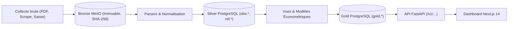

# Irooa Ketrika Agri Market Intelligence — Audit Exhaustif et Guide Pratique Utilisateur

> **Date :** Novembre 2026  
> **Auteur :** Antigravity AI  
> **Statut :** Document de référence fonctionnel et tutoriel d'exploitation pour utilisateurs et analystes  

---

# Table des Matières

- [I. Audit Exhaustif des Fonctionnalités de l'Application](#i-audit-exhaustif-des-fonctionnalités-de-lapplication)
  - [1. Architecture Technique & Principes Non Négociables (Zero Mock & 100% Provenance)](#1-architecture-technique--principes-non-négociables-zero-mock--100-provenance)
  - [2. Module 1 : Vue d'Ensemble du Marché (`/`)](#2-module-1--vue-densemble-du-marché-)
  - [3. Module 2 : Prix Vivriers & Extrapolations Prédictives Multi-Modèles (`/prices`)](#3-module-2--prix-vivriers--extrapolations-prédictives-multi-modèles-prices)
  - [4. Module 3 : Cartographie Territoriale & Disparités Régionales (`/map`)](#4-module-3--cartographie-territoriale--disparités-régionales-map)
  - [5. Module 4 : Commerce Extérieur & Flux Douaniers (`/trade`)](#5-module-4--commerce-extérieur--flux-douaniers-trade)
  - [6. Module 5 : Observatoire Macroéconomique & Conjoncture (`/economy`)](#6-module-5--observatoire-macroéconomique--conjoncture-economy)
  - [7. Module 6 : Agroclimatologie & Météo Régionale (`/climate`)](#7-module-6--agroclimatologie--météo-régionale-climate)
  - [8. Module 7 : Copilote Analyste IA (`/copilot`)](#8-module-7--copilote-analyste-ia-copilot)
  - [9. Module 8 : Bulletins Hebdomadaires de Veille (`/bulletins`)](#9-module-8--bulletins-hebdomadaires-de-veille-bulletins)
  - [10. Module 9 : Système d'Alertes Précoces (`/alerts`)](#10-module-9--système-dalertes-précoces-alerts)
  - [11. Module 10 : Catalogue Dynamique & Ingestion de Relevés (`/products`)](#11-module-10--catalogue-dynamique--ingestion-de-relevés-products)
  - [12. Module 11 : Registre des Sources & Traçabilité DataOps (`/sources`)](#12-module-11--registre-des-sources--traçabilité-dataops-sources)
  - [13. Module 12 : Supervision & Traçabilité Unitaire (`/observations/[id]`, `/system`, `/admin/review`)](#13-module-12--supervision--traçabilité-unitaire-observationsid-system-adminreview)
- [II. Guide Utilisateur Pas-à-Pas (Tutoriel Complet)](#ii-guide-utilisateur-pas-à-pas-tutoriel-complet)
  - [Étape 0 : Prise en Main & Connexion à la Plateforme](#étape-0--prise-en-main--connexion-à-la-plateforme)
  - [Tutoriel 1 : Consulter et Analyser les Prix d'un Produit Vivrier](#tutoriel-1--consulter-et-analyser-les-prix-dun-produit-vivrier)
  - [Tutoriel 2 : Maîtriser les Prédictions et la Matrice d'Extrapolation à 12 Mois](#tutoriel-2--maîtriser-les-prédictions-et-la-matrice-dextrapolation-à-12-mois)
  - [Tutoriel 3 : Explorer les Territoires et Disparités Régionales](#tutoriel-3--explorer-les-territoires-et-disparités-régionales)
  - [Tutoriel 4 : Ajouter un Nouveau Produit et Importer des Relevés Réels](#tutoriel-4--ajouter-un-nouveau-produit-et-importer-des-relevés-réels)
  - [Tutoriel 5 : Poser des Questions au Copilote Analyste](#tutoriel-5--poser-des-questions-au-copilote-analyste)
  - [Tutoriel 6 : Suivre et Acquitter les Alertes de Marché](#tutoriel-6--suivre-et-acquitter-les-alertes-de-marché)
  - [Tutoriel 7 : Consulter et Approuver un Bulletin de Veille Hebdomadaire](#tutoriel-7--consulter-et-approuver-un-bulletin-de-veille-hebdomadaire)
- [III. Foire Aux Questions (FAQ) & Lexique](#iii-foire-aux-questions-faq--lexique)

---

# I. Audit Exhaustif des Fonctionnalités de l'Application

## 1. Architecture Technique & Principes Non Négociables (Zero Mock & 100% Provenance)

L'application Irooa Ketrika repose sur un pipeline de données en couches strictes : **Bronze → Silver → Gold**, conçu pour proscrire toute hallucination et toute donnée fictive.

### Les règles d'intégrité fondamentales :
1. **Provenance totale (Principe 1 AGENTS.md) :** Toute observation de prix, flux commercial ou indicateur météo en base référence un enregistrement `meta.source_record`, qui pointe directement vers un objet brut dans le bucket MinIO Bronze avec son empreinte `content_sha256`.
2. **Bronze immuable (Principe 2) :** Aucun fichier collecté n'est jamais modifié ou supprimé.
3. **Ajout seul (Principe 3) :** Les mises à jour créent de nouvelles lignes Silver et horodatent les anciennes via `superseded_by`.
4. **Rejouabilité totale (Principe 4) :** Toute la base de données peut être entièrement recalculée à froid hors ligne via `./scripts/dev.ps1 rebuild` à partir des fichiers Bronze et des déclarations taxonomiques YAML.
5. **Transparence métrologique (Principe 9) :** Chaque valeur affichée dans l'interface porte obligatoirement la mention de sa nature :
   - `observed` : Relevé de terrain réel directement constaté.
   - `imputed` : Valeur estimée par une méthode statistique explicitée.
   - `forecast` : Projection calculée par un modèle prédictif explicable.

---

## 2. Module 1 : Vue d'Ensemble du Marché (`/`)

### Rôle et objectifs
La page d'accueil offre une synthèse instantanée de la santé du marché pour la denrée vivrière sélectionnée (Riz blanc local, Riz importé, Huile, Sucre, Farine, Maïs, etc.).

### Composants & Fonctionnement technique
- **Bandeau de KPIs Clés :**
  - *Dernier prix médian observé* : calculé sur la période la plus récente disponible avec mention du mois et de l'unité (ex: `3 400 Ar/kg`).
  - *Tendance courte (1 mois)* : variation en pourcentage par rapport au mois précédent ($\Delta M-1$).
  - *Tendance moyenne (3 mois)* : variation par rapport au trimestre antérieur ($\Delta M-3$).
  - *Dispersion territoriale* : amplitude entre le prix minimum et le prix maximum relevés à travers Madagascar pour ce même produit.
  - *Alertes actives* : nombre de signaux de tension ou d'anomalie ouverts sur ce produit.
- **Graphique interactif d'évolution :**
  - Affiche la série chronologique historique des prix réels avec affichage de la fourchette `[min_price, max_price]`.
  - Raccorde automatiquement la projection prédictive à court terme avec ses intervalles de confiance.
- **Flux d'API :**
  - `GET /v1/prices?product={code}` (interroge `gold.price_monthly`).
  - `GET /v1/forecasts?product={code}` (interroge `gold.price_forecast`).
  - `GET /v1/alerts?state=open` (interroge `ops.alert`).

---

## 3. Module 2 : Prix Vivriers & Extrapolations Prédictives Multi-Modèles (`/prices`)

### Rôle et objectifs
C'est le cœur analytique de la plateforme. Il permet d'étudier l'historique complet d'un produit, de comparer différentes méthodologies de prévision et de projeter les prix jusqu'à **12 mois** dans le futur.

### Fonctionnalités auditées :
1. **Contrôleur d'horizon temporel (1 à 12 mois) :**
   - Un curseur interactif et des boutons rapides (+1m, +3m, +6m, +12m) permettent à l'analyste de choisir la profondeur de projection.
2. **Sélecteur de Technique Prédictive :**
   - ⭐ **Sélection Recommandée (Vainqueur)** : Sélectionne automatiquement le modèle qui a obtenu le plus faible taux d'erreur (MAPE minimal) lors du backtest rigoureux sur les 6 dernières fenêtres glissantes.
   - 🌟 **Consensus Multi-Modèles (Ensemble)** : Synthèse équipondérée ou bayésienne de tous les modèles candidats.
   - 📈 **AutoARIMA (Box-Jenkins)** : Modèle autorégressif à moyenne mobile avec différentiation saisonnière automatique.
   - 📉 **AutoETS (Lissage Exponentiel)** : Décomposition niveau-tendance-saisonnalité pour capturer les cycles de récolte.
   - 🔄 **Saisonnalité Naïve (SNaïf)** : Réplication des variations constatées 12 mois plus tôt (idéal pour les saisons des pluies / périodes de soudure).
   - ⏱️ **Dernière Valeur Constatée (Naïf)** : Hypothèse de constance des prix (baseline de référence).
3. **Matrice Comparative Déroulante (Bouton « Afficher la matrice ») :**
   - Tableau complet alignant mois par mois (de $h=1$ à $h=12$) les prédictions chiffrées de chaque technique côte-à-côte.
   - Affiche pour chaque modèle :
     - La trajectoire médiane projetée en Ar/kg.
     - L'intervalle de confiance conforme à 80% `[P10 – P90]`.
     - L'écart absolu et relatif par rapport au dernier prix réel observé.
4. **Gestion de l'Abstention Gracieuse (Zéro Donnée Fictive) :**
   - Si une série comporte moins de 24 mois réels d'historique (ex: nouveau produit ajouté manuellement), le moteur s'abstient et l'interface affiche un badge explicatif transparent indiquant que les modèles exigent au moins 24 mois réels pour projeter des tendances fiables.

---

## 4. Module 3 : Cartographie Territoriale & Disparités Régionales (`/map`)

### Rôle et objectifs
Visualiser la répartition géographique des prix à travers les **23 régions de Madagascar** (d'Analamanga à la Sava).

### Fonctionnalités auditées :
- **Carte Choroplèthe Interactive SVG :**
  - Coloration thermique des régions selon le niveau de prix (vert = accessible, jaune = moyen, rouge = prix élevé).
  - Gestion stricte des données manquantes : les régions sans relevé vérifié restent grisées avec mention « Non renseigné » plutôt que d'inventer une valeur.
- **Carte Repère National :**
  - Affiche le cours de parité national ou la médiane globale de Madagascar pour servir d'étalon comparatif.
- **Volet Régional Détaillé :**
  - Clic sur une région : affiche le prix médian, la source du relevé (ex: CSA, Observatoire du Riz, PAM), l'unité de mesure et la date de la collecte.

---

## 5. Module 4 : Commerce Extérieur & Flux Douaniers (`/trade`)

### Rôle et objectifs
Suivre les volumes physiques et financiers des échanges transfrontaliers de Madagascar sur les produits vivriers majeurs.

### Fonctionnalités auditées :
- **Statistiques Douanières Réelles (`obs.trade_flow`) :**
  - Volumes d'importations et d'exportations en **tonnes métriques**.
  - Valeur CAF (Coût, Assurance, Fret) pour les importations et FOB (Franco à bord) pour les exportations, exprimées en **MGA** et en **USD**.
- **Tableau mensuel exhaustif :**
  - Ventilation par nomenclature douanière SH6 (ex: `100630` pour le riz blanchi, `151190` pour l'huile de palme raffinée).
  - Liens de provenance vers les bulletins officiels de la Direction Générale des Douanes.

---

## 6. Module 5 : Observatoire Macroéconomique & Conjoncture (`/economy`)

### Rôle et objectifs
Surveiller les variables exogènes qui influencent directement le pouvoir d'achat et le coût de revient des denrées vivrières.

### Fonctionnalités auditées :
- **5 Dimensions Économiques Normalisées :**
  1. *Taux de Change* : Cours officiel USD/MGA et EUR/MGA de la Banque Centrale de Madagascar (BFM).
  2. *Carburants & Énergie* : Barème officiel des prix plafonds de l'Office Malgache des Hydrocarbures (OMH) pour le Gazole, le Supercarburant et le Pétrole lampant.
  3. *Inflation & Prix à la Consommation* : NIPC national et composante alimentaire de l'INSTAT.
  4. *Commerce Extérieur* : Valeurs et tonnages douaniers vivriers.
  5. *Activité Réelle* : Tableau de Bord Économique (TBE) de l'INSTAT.
- **14 Fiches Métriques Documentées :**
  - Chaque indicateur dispose d'une fiche méthodologique dépliable détaillant sa formule mathématique exacte, son unité légale, sa fréquence, sa source institutionnelle et ses limites d'interprétation.
- **Export CSV Direct :** Téléchargement instantané des séries économiques nettoyées.

---

## 7. Module 6 : Agroclimatologie & Météo Régionale (`/climate`)

### Rôle et objectifs
Anticiper les chocs d'offre agricole en analysant la pluviométrie, les températures et les calendriers culturaux régionaux.

### Fonctionnalités auditées :
- **Données Météorologiques Satellitaires & Sol :**
  - Précipitations mensuelles et décadaires en millimètres (CHIRPS v2.0 / NASA POWER).
  - Calcul des anomalies pluviométriques par rapport à la normale historique trentenaire.
- **Calendriers Culturaux Régionaux :**
  - Suivi des phases phénologiques pour le riz (Vary Vakiambiaty, Vary Asery, Vary Hosy), le maïs et le manioc.
  - Identification des mois de semis, de croissance et de pic de récolte.
- **Corridors Commerciaux & Vulnérabilité :**
  - Cartographie des liens entre bassins de production excédentaires (ex: Alaotra-Mangoro) et grands centres de consommation déficitaires (ex: Analamanga/Antananarivo).

---

## 8. Module 7 : Copilote Analyste IA (`/copilot`)

### Rôle et objectifs
Permettre aux décideurs et analystes d'interroger la base de données en langage naturel avec une garantie absolue de fidélité aux chiffres réels.

### Fonctionnalités auditées :
- **SQL Guard & Anti-Hallucination Stricte (Principes 6 & 7) :**
  - La question utilisateur est traduite en requête SQL SELECT sécurisée, sans droit d'écriture, exécutée en direct sur PostgreSQL.
  - La réponse en texte générée ne peut mentionner aucun chiffre qui ne figure pas explicitement dans le résultat de la requête exécutée.
  - Les citations précises des observations sources sont fournies avec chaque réponse.
- **Console d'audit intégrée :**
  - L'utilisateur peut déployer l'onglet technique pour examiner la requête SQL exécutée sous le capot.

---

## 9. Module 8 : Bulletins Hebdomadaires de Veille (`/bulletins`)

### Rôle et objectifs
Automatiser la production de rapports périodiques de synthèse pour les ministères, ONG, bailleurs et opérateurs économiques.

### Fonctionnalités auditées :
- **Cycle de Vie Éditorial :**
  - État `draft` (Brouillon généré automatiquement à partir des données de la semaine).
  - État `approved` (Revue et validation formelle par un analyste ou administrateur).
  - État `published` / `sent` (Diffusion enregistrée).
- **Structure des faits vérifiés :**
  - Chaque chiffre du bulletin est lié par un bouton cliquable « Pièce 1, 2… » qui renvoie vers la preuve d'origine de l'observation.

---

## 10. Module 9 : Système d'Alertes Précoces (`/alerts`)

### Rôle et objectifs
Détecter automatiquement les comportements anormaux du marché et les risques de rupture d'approvisionnement.

### Fonctionnalités auditées :
- **Typologie des Règles Évaluées :**
  - *Flambée brutale des cours* : hausse du prix de détail supérieure à $+15\%$ sur un mois.
  - *Déficit pluviométrique sévère* : anomalie pluviométrique inférieure à $-30\%$ durant la phase critique de floraison du riz.
  - *Rupture de parité d'importation* : prix local anormalement déconnecté du cours international CAF.
- **Gestion du Cycle d'Alerte :**
  - Filtrage par statut : `open` (À examiner), `acknowledged` (Prise en compte), `resolved` (Clôturée).
  - Boutons d'action rapides pour les analystes et administrateurs.

---

## 11. Module 10 : Catalogue Dynamique & Ingestion de Relevés (`/products`)

### Rôle et objectifs
Permettre aux utilisateurs d'enrichir le système avec de nouvelles denrées agricoles et d'injecter des relevés de terrain avec traçabilité Bronze garantie.

### Fonctionnalités auditées :
- **Formulaire « + Nouveau Produit » :**
  - Saisie du code canonique normalisé (ex: `VANILLA_BOURBON`).
  - Nom officiel français, catégorie vivrière, unité de base (`kg`, `l`, `t`), codes douaniers SH6.
  - Enregistrement des synonymes et appellations locales (ex: `voanjobory`, `tongolo`).
  - Écriture miroir réversible dans [`taxonomy/products.yaml`](file:///mnt/c/Users/raillersing/Documents/%23Entreprise/Ketrika%20AI/AI%20Agent/taxonomy/products.yaml) et rechargement à chaud de `ProductResolver`.
- **Formulaire « Importer des relevés » :**
  - Saisie de la date, de la région (P-code), du stade de vente (`retail`, `wholesale`, `farmgate`), du prix en MGA et du libellé source.
  - Stockage immédiat dans MinIO Bronze sous empreinte immuable `sha256`.
  - Rafraîchissement atomique des vues Gold (`gold.price_monthly`).

---

## 12. Module 11 : Registre des Sources & Traçabilité DataOps (`/sources`)

### Rôle et objectifs
Assurer la gouvernance et le monitoring continu des 18 sources de données publiques et officielles intégrées à la plateforme.

### Fonctionnalités auditées :
- **Fiches Sources Détaillées :**
  - Nom institutionnel, méthode d'accès (API, Scraping, Snapshot, Relevé direct), fréquence attendue.
  - SLA de fraîcheur (Freshness SLA en jours) et détection automatique des retards de publication (`stale`).
- **Journal d'Exécution (Runs) :**
  - Historique des collectes automatiques avec durée, nombre d'enregistrements ingérés et statut HTTP.

---

## 13. Module 12 : Supervision & Traçabilité Unitaire (`/observations/[id]`, `/system`, `/admin/review`)

### Rôle et objectifs
Garantir la vérifiabilité juridique et technique de chaque valeur affichée.

### Fonctionnalités auditées :
- **Page `/observations/[id]` :**
  - Affiche le « passeport » complet d'un point de données : chaîne de hachage SHA-256 de l'artefact MinIO Bronze, date exacte de capture, URL de collecte, valeurs brutes extraites (`price_raw`, `product_raw`, `location_raw`).
  - Bouton de téléchargement du fichier brut d'origine.
- **Page `/system` :**
  - Monitoring des conteneurs locaux (API FastAPI : port 8090, Web Next.js : port 3005, MinIO : port 9101, PostgreSQL : port 5434, Mailpit : port 8025).
  - Commandes utiles et raccourcis d'administration.
- **Page `/admin/review` :**
  - File d'attente de modération pour les correspondances d'alias à faible score de confiance et les anomalies de saisie.

---

# II. Guide Utilisateur Pas-à-Pas (Tutoriel Complet)

Ce guide est spécialement conçu pour permettre à un utilisateur novice ou analyste métier de naviguer avec aisance sur la plateforme Irooa Ketrika.

---

## Étape 0 : Prise en Main & Connexion à la Plateforme

1. Ouvrez votre navigateur internet (Chrome, Firefox ou Edge) et rendez-vous sur l'adresse :  
   👉 **`http://localhost:3005`**
2. Si vous n'êtes pas connecté, l'application vous redirigera vers la page de connexion :
   - **Adresse e-mail :** `admin@ketrika.local`
   - **Mot de passe :** `change-me`
3. Cliquez sur **« Se connecter »**. Vous accédez immédiatement au tableau de bord général.

> [!TIP]
> **Le bandeau supérieur de filtres :**  
> Présent en haut de presque toutes les pages, il vous permet à tout moment de changer de **Produit** (ex: Riz blanc local), de **Zone** (ex: Analamanga) ou de **Stade de vente** (Gros, Détail, Bord champ). En modifiant ces options, tous les graphiques de la page s'actualisent instantanément !

---

## Tutoriel 1 : Consulter et Analyser les Prix d'un Produit Vivrier

*Objectif : Savoir comment observer les prix réels actuels et historiques d'une denrée.*

1. Dans le menu de gauche, cliquez sur **« Prix vivriers »** (ou allez sur `http://localhost:3005/prices`).
2. Dans le bandeau supérieur, sélectionnez le produit souhaité, par exemple **Riz blanc local** (ou `RICE_WHITE_LOCAL`).
3. Vous découvrez plusieurs informations :
   - **Les indicateurs récapitulatifs en haut :**
     - Le dernier prix médian relevé en Ariary (ex: `3 300 Ar / kg`).
     - L'évolution sur 1 mois et sur 3 mois.
     - L'amplitude observée entre les marchés les moins chers et les plus chers.
   - **Le grand graphique interactif :**
     - La courbe continue représente l'évolution réelle des prix mois par mois.
     - En passant votre souris sur les points de la courbe, vous pouvez voir le prix exact du mois, la source du relevé et le nombre d'observations collectées.
   - **Les badges de qualification :**
     - Un badge vert **« Observé »** certifie que le chiffre provient d'un relevé de marché réel vérifié.
     - Un badge orange **« Prévu »** indique une projection mathématique pour les mois à venir.

---

## Tutoriel 2 : Maîtriser les Prédictions et la Matrice d'Extrapolation à 12 Mois

*Objectif : Anticiper l'évolution des prix sur les prochains mois et comparer les différents scénarios économiques.*

1. Sur la page **« Prix vivriers »**, descendez jusqu'à l'encart orange intitulé **« Extrapolations Prédictives Multi-Modèles »**.
2. **Choisir l'horizon temporel :**
   - Utilisez le curseur horizontal ou cliquez sur **« +3 mois »**, **« +6 mois »** ou **« +12 mois »**.
   - La courbe du graphique principal s'étend immédiatement dans le futur pour tracer la trajectoire prévue sur la période choisie !
3. **Tester les différentes techniques de prévision :**
   - Cliquez sur les boutons de sélection :
     - Cliquez sur **⭐ Sélection Recommandée** pour voir la prévision du modèle le plus précis historiquement.
     - Cliquez sur **🌟 Consensus Multi-Modèles** pour voir une moyenne équilibrée de toutes les approches.
     - Cliquez sur **AutoARIMA** pour privilégier les dynamiques de séries temporelles statistiques.
     - Cliquez sur **Saisonnalité Naïve** pour voir l'impact pur des cycles agricoles annuels.
4. **Ouvrir la Matrice Comparative complète :**
   - Cliquez sur le gros bouton orange :  
     **« Afficher la matrice comparative de tous les modèles »** (ou « Cliquer pour ouvrir le tableau »).
   - Un tableau détaillé s'ouvre sous vos yeux :
     - En colonnes : chaque mois futur (ex: *nov. 2026 (h=1)*, *déc. 2026 (h=2)*, *janv. 2027 (h=3)*…).
     - En lignes : chacune des techniques mathématiques candidates.
     - Vous pouvez ainsi comparer d'un seul coup d'œil si tous les modèles s'accordent sur une hausse future ou si certains prévoient une stabilisation !
   - Pour refermer le tableau, cliquez simplement sur **« Masquer la matrice comparative »**.

---

## Tutoriel 3 : Explorer les Territoires et Disparités Régionales

*Objectif : Comparer le prix d'un produit entre différentes régions de Madagascar.*

1. Dans le menu de gauche, cliquez sur **« Territoires »** (ou allez sur `http://localhost:3005/map`).
2. Sélectionnez votre produit en haut (ex: *Huile alimentaire* ou *Riz blanc local*).
3. **Lire la carte de Madagascar :**
   - Les 23 régions apparaissent colorées selon la cherté relative du produit.
   - Les régions plus vertes indiquent des prix plus bas (souvent les zones de forte production agricole).
   - Les régions plus orangées ou rouges indiquent des prix plus élevés (zones enclavées ou fortement importatrices).
4. **Consulter une région :**
   - Cliquez sur n'importe quelle région de la carte (ex: *Alaotra-Mangoro* ou *Atsinanana*).
   - Un encadré s'affiche avec le prix médian constaté dans cette région, l'écart avec la moyenne nationale et la source qui a fourni la donnée.

---

## Tutoriel 4 : Ajouter un Nouveau Produit et Importer des Relevés Réels

*Objectif : Enrichir l'application avec vos propres denrées (ex: café, oignon, vanille) et enregistrer vos prix collectés sur le terrain avec 100% de traçabilité.*

### A. Ajouter un nouveau produit au catalogue
1. Dans le menu de gauche, cliquez sur **« Produits »** sous *Gestion des données* (ou cliquez sur le lien rapide **`+ Gérer`** situé en haut à côté du sélecteur de produit).
2. Cliquez sur le bouton bleu **« + Nouveau Produit »** en haut à droite.
3. Remplissez le formulaire :
   - **Code Produit unique :** Donnez un code en majuscules (ex: `OIGNON_LOCAL` ou `VANILLE_BOURBON`).
   - **Nom officiel en français :** Nom complet (ex: *Oignon rouge local*).
   - **Catégorie :** Choisissez parmi la liste déroulante (ex: *Maraîchage / Légume*, *Épice*, *Culture de rente*…).
   - **Unité de mesure :** Entrez l'unité standard (ex: `kg`).
   - **Code douanier SH6 (optionnel) :** Code à 6 chiffres si connu (ex: `070310`).
   - **Synonymes / Alias :** Mettez les variantes de nom et termes en malgache séparés par des virgules (ex: `oignon, oignon rouge, tongolo`). Cela permettra à la recherche et au copilote de reconnaître immédiatement le produit !
4. Cliquez sur **« Enregistrer le produit »**.  
   ✅ Le produit est instantanément créé en base et devient sélectionnable partout dans l'application !

### B. Enregistrer des prix réels pour ce produit
1. Sur la page **« Produits »**, repérez votre denrée dans la liste et cliquez sur le bouton **« Importer des relevés »**.
2. Remplissez les données de votre observation :
   - **Date du relevé :** La date exacte de constatation du prix (ex: `2026-10-15`).
   - **Zone géographique (P-code) :** Entrez `MDG` pour une échelle nationale, ou le code d'une région (ex: `MDG11` pour Analamanga).
   - **Stade de vente :** Choisissez *Détail (consommateur)*, *Gros (marché de gros)* ou *Bord champ (producteur)*.
   - **Prix unitaire constaté :** Montant en Ariary (ex: `3 200`).
   - **Nom de la source :** D'où provient le prix (ex: *Relevé terrain marché d'Anosibe*).
3. Cliquez sur **« Enregistrer l'observation »**.  
   ✅ Votre relevé est immédiatement stocké dans le coffre-fort numérique Bronze MinIO avec son empreinte SHA-256 infalsifiable.  
   Le prix moyen est automatiquement recalculé et s'affiche instantanément dans vos graphiques sur `/prices` !

---

## Tutoriel 5 : Poser des Questions au Copilote Analyste

*Objectif : Obtenir des analyses rapides, des calculs et des chiffres vérifiés sans chercher manuellement dans les tableaux.*

1. Dans le menu de gauche, cliquez sur **« Assistant »** (ou allez sur `http://localhost:3005/copilot`).
2. Vous arrivez sur une interface de discussion intuitive.
3. **Poser une question :**
   - Vous pouvez cliquer sur l'un des exemples suggérés en haut (ex: *« Quel est le prix médian du riz blanc à Analamanga sur les 6 derniers mois ? »*).
   - Ou taper votre propre question dans la zone de texte en bas, par exemple :
     > *« Quelles sont les 3 régions où le maïs est le plus cher actuellement ? »*  
     > *« Quels ont été les volumes de riz importés au dernier trimestre ? »*
4. Cliquez sur le bouton d'envoi.
5. **Comprendre la réponse :**
   - L'assistant vous répond en français clair avec les chiffres exacts extraits de la base.
   - **Zéro hallucination garantie :** Chaque chiffre cité est extrait directement par une requête SQL sur les données réelles.
   - Vous pouvez cliquer sur le bandeau **« Requête SQL exécutée »** pour voir exactement comment l'assistant a interrogé la base de données.

---

## Tutoriel 6 : Suivre et Acquitter les Alertes de Marché

*Objectif : Détecter les tensions d'approvisionnement et gérer le suivi opérationnel des signaux.*

1. Dans le menu de gauche, cliquez sur **« Alertes »** (ou allez sur `http://localhost:3005/alerts`).
2. En haut, visualisez le nombre d'alertes ouvertes et leur niveau de criticité.
3. **Examiner une alerte :**
   - Cliquez sur l'une des alertes dans la colonne de gauche (ex: *« Hausse rapide du riz blanc à Atsinanana (+18%) »*).
   - Le volet de droite affiche le diagnostic détaillé : la règle déclenchée, la date du premier signalement, et les preuves chiffrées enregistrées.
4. **Mettre à jour le statut :**
   - Cliquez sur **« Prendre en compte »** (`acknowledged`) pour signifier à votre équipe que l'anomalie est en cours d'investigation.
   - Une fois la situation résolue ou vérifiée, cliquez sur **« Marquer comme résolue »** (`resolved`).

---

## Tutoriel 7 : Consulter et Approuver un Bulletin de Veille Hebdomadaire

*Objectif : Relire les éditions synthétiques avant leur diffusion externe.*

1. Dans le menu de gauche, cliquez sur **« Bulletins »** (ou allez sur `http://localhost:3005/bulletins`).
2. Cliquez sur **« Lire le bulletin »** sur l'édition de votre choix.
3. Vous accédez à la page complète du rapport :
   - Les indicateurs synthétiques de la semaine écoulée.
   - La liste de tous les faits chiffrés avec leurs boutons **« Pièce 1 »**, **« Pièce 2 »** permettant de vérifier la traçabilité de chaque information.
4. Si vous disposez des droits administrateur et que l'édition est en brouillon (`draft`), cliquez sur le bouton vert **« Approuver le bulletin »** pour valider formellement la publication.

---

# III. Foire Aux Questions (FAQ) & Lexique

### Q1 : Pourquoi mon nouveau produit n'a-t-il pas encore de courbe de prévision ?
> **Réponse :** Pour respecter la constitution de fiabilité de la plateforme (AGENTS.md §4), les modèles d'apprentissage automatique et économétriques exigent un **historique minimal de 24 mois réels** de relevés pour s'entraîner sans fabriquer de données fictives. Dès que vous aurez accumulé 24 mois d'observations pour ce produit, les prévisions et la matrice comparative s'activeront automatiquement !

### Q2 : Quelle est la différence entre un prix « Observé » et un prix « Imputé » ?
> - **Observé (badge vert) :** Le prix a été directement mesuré sur un marché physique ou extrait d'un relevé officiel.
> - **Imputé (badge violet) :** Le prix n'ayant pas pu être relevé sur une période précise, il a été déduit par une formule statistique validée (ex: parité nationale ou régression linéaire bornée).

### Q3 : Comment prouver à un partenaire ou à un auditeur qu'un chiffre est vrai ?
> Cliquez sur le bouton de traçabilité (ou note de bas de tableau) attaché au chiffre pour ouvrir sa fiche `/observations/[id]`. Vous y trouverez l'empreinte cryptographique SHA-256 de l'artefact original stocké dans MinIO Bronze ainsi que la date exacte et l'URL source de la collecte.

### Q4 : Que signifient les colonnes [P10 – P90] dans la matrice comparative ?
> Il s'agit de **l'intervalle de confiance conforme à 80 %** :
> - **P10 :** Scénario plancher (il n'y a que 10 % de chances que le prix réel tombe en dessous de cette valeur).
> - **P90 :** Scénario plafond (il n'y a que 10 % de chances que le prix réel dépasse cette valeur).  
> Plus l'écart entre P10 et P90 est étroit, plus la projection du modèle est considérée comme stable et fiable.

---
*Fin du document — Irooa Ketrika Agri Market Intelligence*
