# Guide de Démonstration 1 — Ketrika Agri Market Intelligence

> Mise à jour2026-10-25 : scénario de démonstration historique, aucune preuve de marché ou de qualification actuelle. Voir [audit indépendant](audits/2026-10-25/INDEPENDENT_AUDIT.md) et [plan correctif](audits/2026-10-25/CORRECTIVE_EXECUTION_PLAN.md).

> **Statut :** Livrable officiel de fin de Phase 7 (T7.3 / Démo 1).  
> **Durée estimée :** 5 minutes.  
> **Public cible :** Décideurs, analystes de marché, bailleurs de fonds, équipes Data & Métier.

---

## 1. Contexte & Mission

**Ketrika Agri Market Intelligence** est la plateforme de référence pour la veille stratégique sur les produits de première nécessité (PPN) vivriers à Madagascar : **riz (makalioka, vary gasy, riz importé), maïs, manioc, huile de table, sucre, légumineuses et farine**.

Face à la fragmentation des données et à la volatilité des prix alimentaires, Ketrika résout le défi de la confiance par un principe non négociable : **la provenance totale et vérifiable à 100 %**. Chaque chiffre exposé dans l'interface et dans l'API est traçable mécaniquement jusqu'au document Bronze original horodaté et immuable.

---

## 2. Accès & Rôles de Démonstration

L'application web Next.js est accessible localement sur [http://localhost:3005](http://localhost:3005).

| Rôle | Email | Mot de passe | Droits & Périmètre |
|---|---|---|---|
| **Administrateur** | `admin@ketrika.local` | `admin123456` | Accès complet : cockpit, graphiques, file de revue, gestion DataOps, résolution d'ambiguïtés |
| **Client / Analyste** | `client@ketrika.local` | `client123456` | Consultation analytique, export CSV, observation provenance ; accès interdit à `/admin/review` (403 RBAC) |

---

## 3. Déroulement du Parcours Démonstrateur (5 minutes)

### Étape 1 : Authentification & Protection par Middleware (0:30)
- **Action :** Accéder à [http://localhost:3005/login](http://localhost:3005/login) ou tenter d'ouvrir une route protégée sans session. Le middleware Next.js intercepte la requête et redirige vers la page d'authentification.
- **Démonstration :** Saisie des identifiants `admin@ketrika.local`. L'API FastAPI (`/v1/auth/login`) délivre un jeton JWT sécurisé, stocké dans un cookie HTTP-only `ketrika_token`.

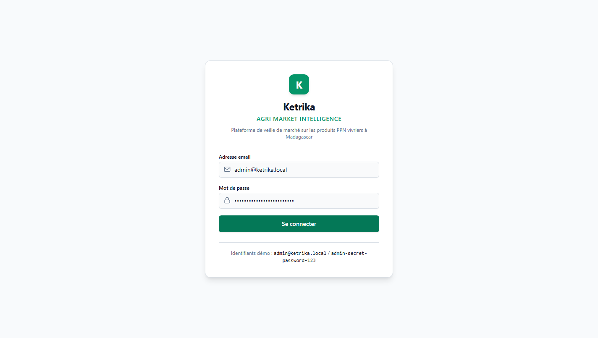

---

### Étape 2 : Vue d'ensemble & Cockpit Exécutif (0:45)
- **Action :** Redirection immédiate vers le tableau de bord principal `/`.
- **Points clés :**
  - **Cartes de KPI exécutifs :** Prix médian national pondéré, variation mensuelle (MoM), Market Health Score global (normalisé sur 100) et taux de couverture des marchés.
  - **Graphique de tendance multi-produits :** Visualisation interactive (Apache ECharts) présentant la dispersion des prix avec rubans interquartiles p10–p90 et distinction visuelle stricte `observed` vs `imputed` vs `forecast`.

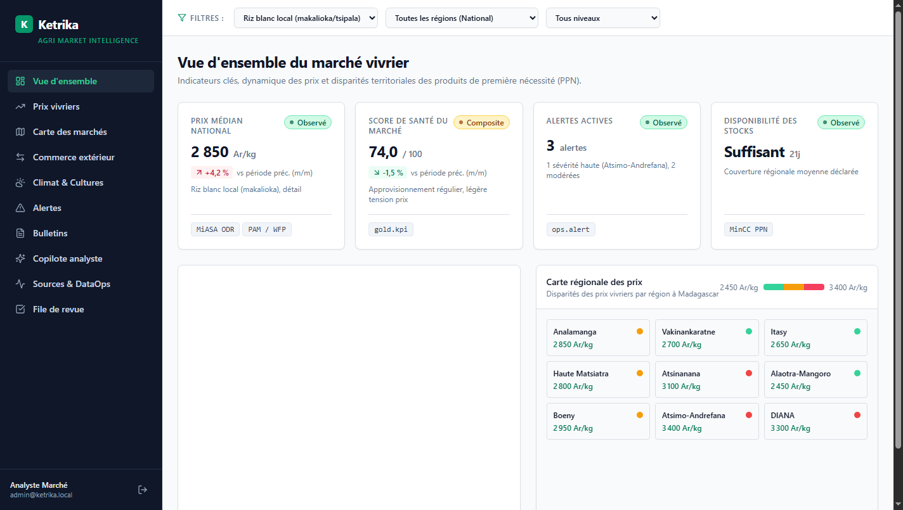

---

### Étape 3 : Explorateur de Prix & Séries Historiques (0:45)
- **Action :** Navigation vers `/prices`.
- **Points clés :**
  - Filtrage multi-critères synchronisé en temps réel dans l'URL (`?product=rice_milled_local&region=MG-T`).
  - Tableau des observations mensuelles Gold (`price_monthly_best`).
  - **Bouton Export CSV :** Téléchargement instantané en streaming via l'API `/v1/prices?format=csv` pour intégration Excel ou Stata.

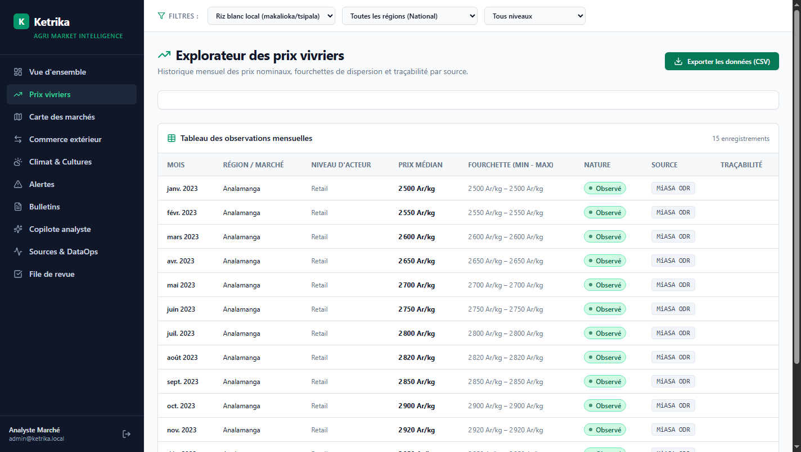

---

### Étape 4 : Carte Interactive & Disparités Régionales (0:30)
- **Action :** Navigation vers `/map`.
- **Points clés :**
  - Carte choroplèthe interactive vectorielle (MapLibre GL) couvrant les 23 régions de Madagascar.
  - Mise en évidence immédiate des écarts de prix entre zones excédentaires (ex. Alaotra-Mangoro) et zones enclavées ou déficitaires (ex. Androy, Atsimo-Atsinanana).

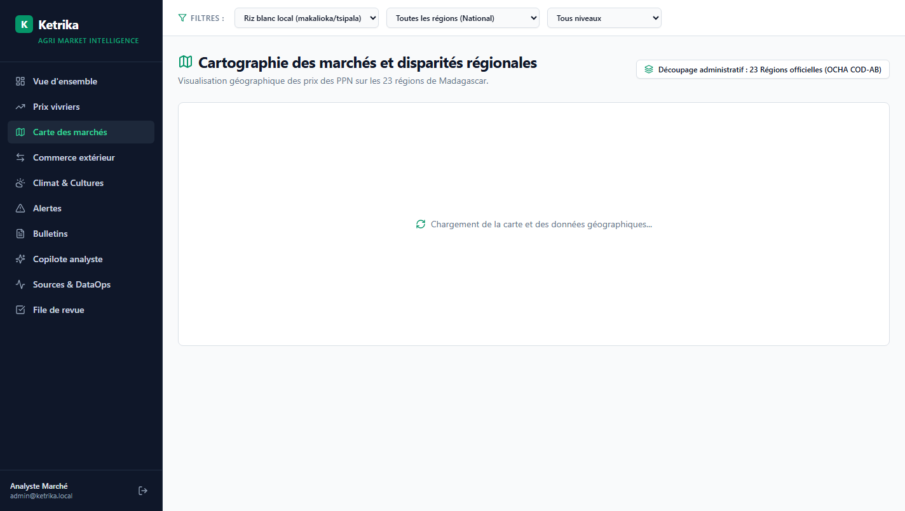

---

### Étape 5 : Commerce Extérieur & Parité d'Importation (0:30)
- **Action :** Navigation vers `/trade`.
- **Points clés :**
  - Analyse des flux douaniers de riz et d'huile (données Douanes de Madagascar / UN Comtrade).
  - Graphiques des volumes importés (tonnes métriques), valeurs CAF déclarées et suivi des origines d'approvisionnement (Inde, Pakistan).

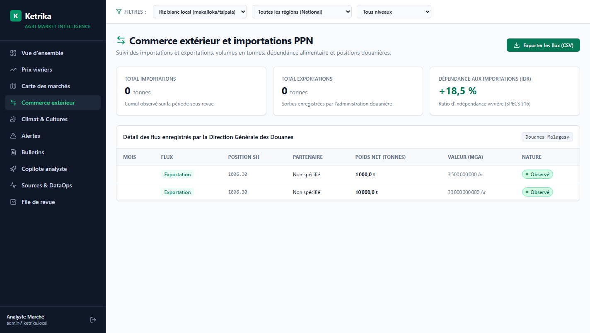

---

### Étape 6 : Climat & Suivi des Précipitations CHIRPS (0:30)
- **Action :** Navigation vers `/climate`.
- **Points clés :**
  - Données satellitaires de précipitations décadaires issues de la mission CHIRPS.
  - Identification des chocs agro-climatiques (sécheresses dans le Sud, passages cycloniques à l'Est) corrélés avec les cycles de soudure agricole.

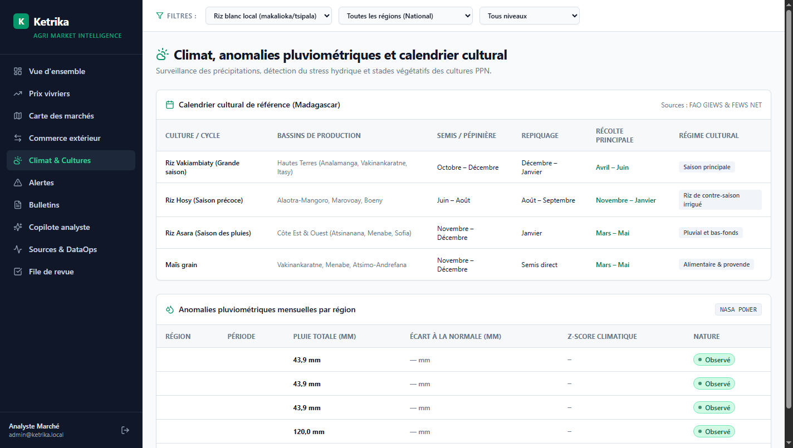

---

### Étape 7 : Le Cœur de Ketrika — Certificat de Provenance Totale (0:45)
- **Action :** Depuis le tableau des prix, cliquer sur le lien de provenance d'une observation, ou accéder directement à `/observations/[id]`.
- **Points clés (Démonstration majeure) :**
  - **Fiche d'audit mécanique :** Affiche la méthode de collecte (`crawler_pdf`, `crawler_api`), l'algorithme d'extraction, la date de collecte exacte et le hash SHA-256 du document source.
  - **Preuve textuelle :** Page exacte et extrait textuel brut garantissant qu'aucun chiffre n'a été inventé par un LLM.
  - **Téléchargement du Bronze original :** Lien sécurisé présigné MinIO/S3 ouvrant le bulletin officiel d'origine (PDF du Ministère ou de l'ODR).

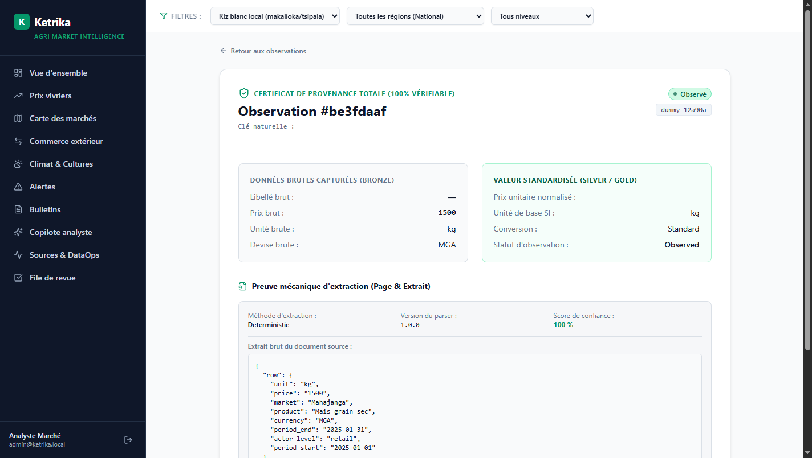

---

### Étape 8 : Moteur d'Alertes & Signaux Précoces (0:30)
- **Action :** Navigation vers `/alerts`.
- **Points clés :**
  - Tableau des alertes détectées de manière déterministe (`PRICE_SPIKE`, `SUPPLY_RUPTURE`, `REGIONAL_DISPARITY`).
  - Badges de sévérité (`CRITICAL`, `WARNING`, `INFO`), historique de première et dernière détection, déduplication automatique.

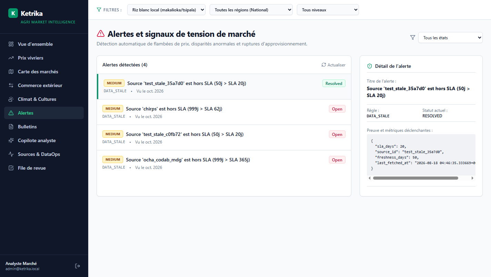

---

### Étape 9 : Bulletins PPN Hebdomadaires & Copilote (0:30)
- **Action :** Navigation vers `/bulletins` et `/copilot`.
- **Points clés :**
  - Les bulletins hebdomadaires générés automatiquement respectent le principe d'interdiction formelle de génération de chiffres libres : 100 % des nombres proviennent de faits Gold vérifiés.
  - L'interface Copilote permet aux analystes d'interroger la base en langage naturel avec citation systématique des sources et identifiants d'observation.

| Bulletins Hebdomadaires | Copilote Analyste |
|---|---|
| 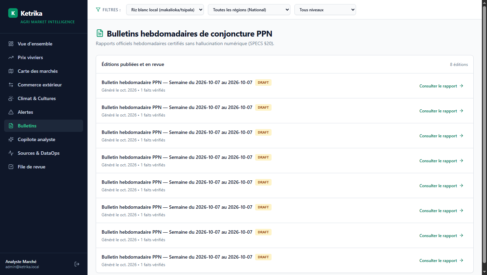 | 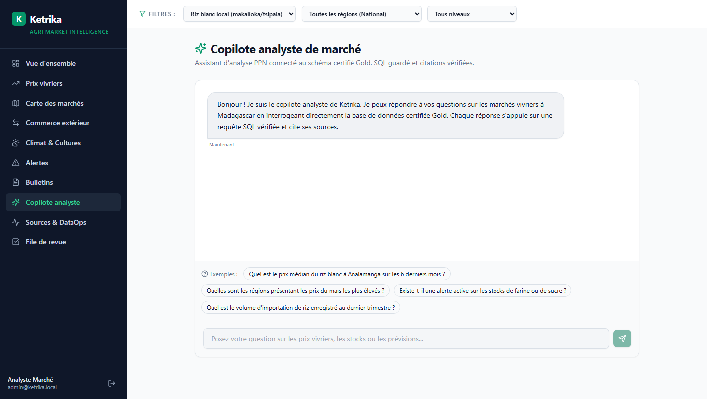 |

---

### Étape 10 : Gouvernance DataOps & File de Revue Humaine (0:45)
- **Action :** Navigation vers `/sources` puis `/admin/review`.
- **Points clés :**
  - **Cockpit DataOps (`/sources`) :** Suivi en temps réel de la fraîcheur des 8 sources de données, respect des SLA (jours depuis la dernière collecte), taux de succès des parsers.
  - **File de revue (`/admin/review`) :** Interface dédiée aux analystes pour arbitrer les produits inconnus, valeurs hors bornes ou conflits géographiques. L'action d'approbation résout l'élément et met à jour la base Gold en temps réel.
  - **Contrôle d'accès RBAC :** Un utilisateur avec le profil client qui tente d'accéder à `/admin/review` se voit refuser l'accès avec un code HTTP 403.

| Observabilité DataOps | File de Revue Humaine |
|---|---|
| 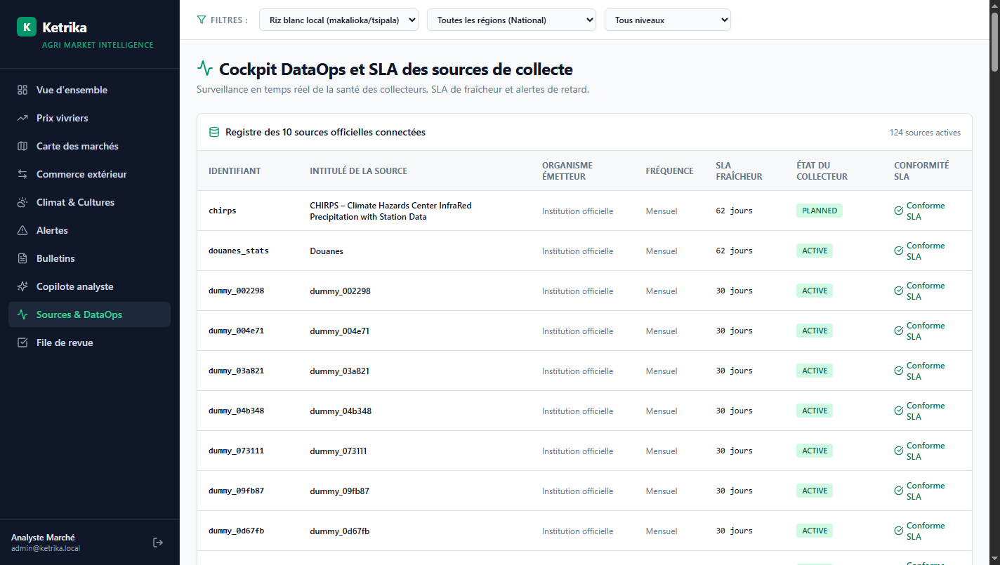 | 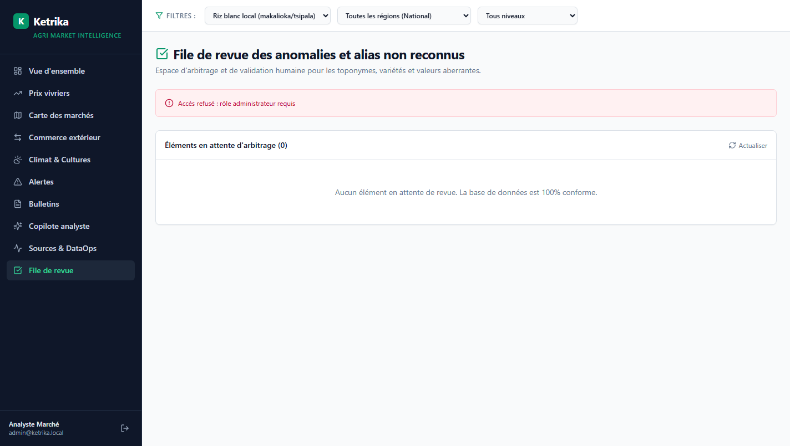 |

---

## 4. Vérification Automatisée des Tests E2E

L'ensemble des parcours de cette démonstration est validé de manière continue par la suite de tests E2E automatisée :

```powershell
./scripts/dev.ps1 e2e
```

**Résultats de validation :**
- 9 scénarios de test complets (authentification, middleware, rendu KPI, exploration, streaming CSV, certificat de provenance, navigation 14 routes, résolution review item, contrôle RBAC, vérification de 0 erreur console).
- **27 assertions validées avec succès, 0 échec, 0 avertissement console.**
- Code de sortie : `0`.
