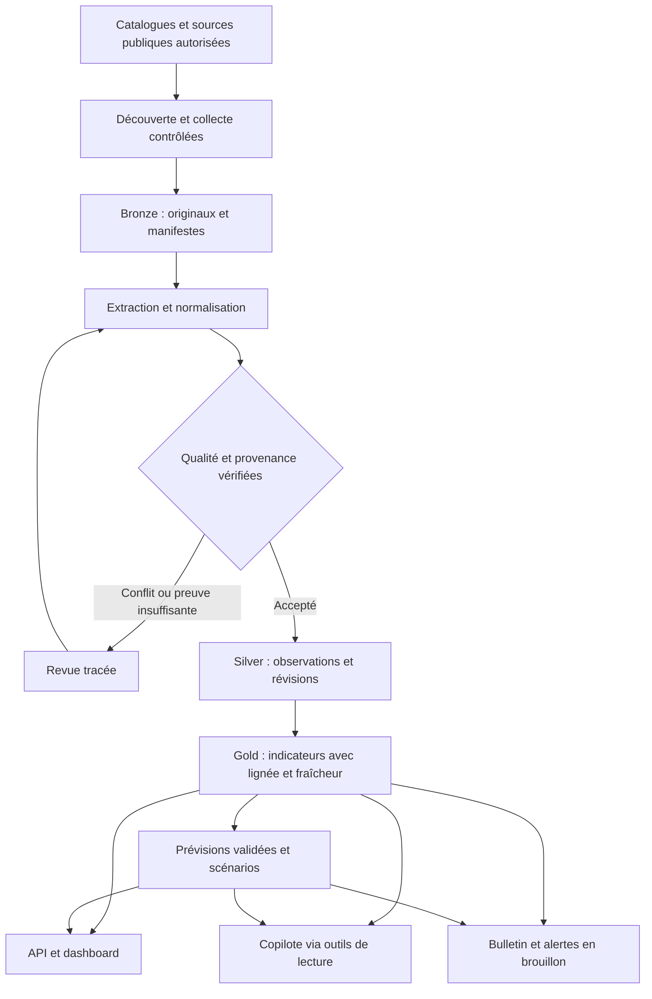

# Ketrika : recherche et audit pour une intelligence de marché à Madagascar

Date : 9 octobre 2026, heure locale. Recherche Web et inspection du code réalisées pendant cette session. HEAD observé : `c8df0f6`. Les constats portent sur les fichiers du répertoire de travail.

Statut : recherche et recommandations. Ce document est informatif ; il ne remplace ni `AGENTS.md`, ni `SPECS.md`, ni le plan normatif. Les extensions proposées ne constituent pas des décisions d'architecture adoptées.

## 1. Conclusion et périmètre de la recherche

Ketrika dispose d'une architecture pertinente pour un observatoire des produits vivriers : stockage Bronze, normalisation, PostGIS, orchestration, API, alertes, bulletin et interface de provenance. L'ambition exprimée demande cependant trois capacités supplémentaires : une collecte réellement qualifiée sur les sources publiques, des prévisions évaluées sur des observations réelles, puis un modèle de disponibilité des produits distinguant récoltes, stocks et approvisionnement des marchés.

La priorité recommandée est de fiabiliser les preuves de fonctionnement avant d'étendre le nombre de sources ou les agents. L'inspection révèle que le scénario d'acceptation injecte des données synthétiques et déclare certains critères réussis sans les mesurer. La déclaration « prêt pour la production » du rapport précédent n'est donc pas établie par ce scénario. Cela ne signifie pas que tous les composants échouent : leur qualification opérationnelle doit être refaite avec des critères exécutables et des données identifiées.

### Méthode

1. Lecture complète d'`AGENTS.md`, lecture de `PROGRESS.md`, `BLOCKERS.md`, des spécifications concernées, du plan, des ADR et du rapport de livraison.
2. Recherche de systèmes institutionnels et commerciaux existants, en privilégiant leurs propres publications.
3. Vérification de sources nationales, économiques, agricoles, météorologiques et environnementales pertinentes pour Madagascar.
4. Comparaison des méthodes de collecte, extraction documentaire, orchestration, prévision et agents avec les contrats et le code du dépôt.
5. Construction d'une feuille de route où chaque lot se termine par une preuve exploitable.

Les preuves sont distinguées ainsi : **code inspecté**, **document primaire consulté**, **référence identifiée mais accès non confirmé**, **recommandation**. La lecture d'une page ne prouve ni une collecte régulière, ni la qualité de toutes ses données, ni les droits de redistribution de chaque fichier.

Cette session ne mesure pas la base locale, les services, le navigateur, les performances ou les tests. Le scénario `demo`, qui peut rejouer des données et injecter des séries synthétiques, n'a pas été exécuté. Aucun achat, envoi externe ou contact de tiers n'a été effectué.

## 2. Ce qui existe déjà et ce que Ketrika peut en retenir

| Système | Fonction attestée | Enseignement pour Ketrika | Limite de comparaison |
|---|---|---|---|
| FAO FPMA / GIEWS | Analyse des séries de prix et de leurs anomalies ; documentation de l'indicateur ODD 2.c.1 | Comparer les prix à leur contexte historique et documenter le signal d'alerte | La présence d'un outil mondial ne garantit pas la couverture de chaque marché malgache |
| PAM/WFP Economic Explorer et ALPS | La documentation annonce une méthode de prévision des prix et d'alerte sur leurs pics | Associer prévision, anomalie et information destinée à une décision | La page de présentation a été lue ; le téléchargement du document détaillé a présenté un challenge et a été arrêté |
| FEWS NET | Perspectives de sécurité alimentaire avec hypothèses, calendriers et événements susceptibles de changer le scénario | Conserver un scénario central, les hypothèses et les facteurs de bascule | Ses analyses de sécurité alimentaire ne sont pas des observations transactionnelles |
| GEOGLAM Crop Monitor | Rapports sur les cultures combinant données spatiales, climat et contribution des partenaires | Articuler signaux automatiques et expertise agronomique | Une condition de culture ne fournit pas directement un volume disponible en marché |
| AMIS | Suivi des marchés, de l'offre, de la demande et des politiques pour de grandes cultures | Relier prix, commerce extérieur, production et décisions réglementaires | Son périmètre international diffère du besoin local |
| JRC ASAP | Alertes agricoles automatiques et analyse des anomalies de production | Analyser les zones cultivées et la saison active | Les avertissements doivent être interprétés dans leur contexte agricole |
| Inde, e-NAM / Agmarknet | Tableau présentant prix, arrivages, variétés, quantités échangées et unités | Le suivi de l'abondance nécessite des quantités, en plus des prix | Il s'appuie sur une infrastructure de relevés qui n'est pas démontrée à Madagascar |
| Tridge | Présentation d'une intelligence agri-alimentaire organisée par produits, prix et flux commerciaux | Une nomenclature métier et des données comparables constituent une part majeure de la valeur | Les capacités annoncées par le fournisseur ne sont pas un benchmark indépendant de performance |

Sources : [FAO, outil FPMA](https://www.fao.org/giews/food-prices/price-tool/en/), [FAO, formation FPMA et ODD 2.c.1](https://elearning.fao.org/course/view.php?id=362), [WFP, présentation des prévisions et ALPS](https://vamresources.manuals.wfp.org/docs/food-price-forecasting-and-alert-for-price-spikes), [FEWS NET Madagascar](https://fews.net/southern-africa/madagascar), [GEOGLAM, structure des rapports](https://www.cropmonitor.org/about-the-reports), [FAO, présentation d'AMIS](https://agritechobservatory.review.fao.org/en/agricultural-market-information-system-amis), [JRC, méthode et masques agricoles ASAP](https://agricultural-production-hotspots.ec.europa.eu/files/JRC137153_Development_of_a_new_cropland_and_rangeland_Area_Fraction_Image_at_500_m_for_the_ASAP.pdf), [e-NAM / Agmarknet](https://www.enam.gov.in/web/dashboard/agmarknet), [Tridge Eye](https://www.tridge.com/about/tridge-eye).

**Interprétation pour Ketrika :** l'avantage potentiel réside dans l'intégration des sources malgaches, leur normalisation, leur actualisation et leur traduction en décisions locales. Accumuler des pages ou produire un résumé par LLM ne suffit pas à construire cette capacité.

La FAO décrit aussi une composante mobile optionnelle de collecte primaire, avec validation avant diffusion dans FPMA. Cela illustre un complément possible aux sources Web lorsque les observations locales manquent ; sa mise en œuvre à Madagascar reste à étudier, sans contact de tiers dans cette session. [Documentation officielle FPMA](https://www.fao.org/giews/food-prices/price-tool/en/).

## 3. Données disponibles et stratégie d'acquisition

### 3.1 Sources nationales

| Source | Données utiles et vérification de cette session | Acquisition recommandée | Limites à conserver |
|---|---|---|---|
| INSTAT NIPC | La page de mars 2026 annonce un historique Excel depuis janvier 2016 ; publication datée du 28 avril 2026 | Découvrir les fichiers depuis les pages officielles ; extraire les feuilles et leurs métadonnées | Un indice n'est pas un prix en Ariary/kg ; la période et la publication sont distinctes |
| INSTAT Tableau de bord économique | Le TBE n°63 d'août 2026 annonce des fichiers Excel et PDF couvrant secteurs réel, public, monétaire et extérieur | Priorité au fichier Excel ; versionner chaque édition | La date du bulletin ne correspond pas à une date unique de toutes les séries |
| Observatoire du Riz | Un bulletin officiel de septembre 2024 est identifié dans l'index de recherche ; sa récupération directe a expiré | Découverte des éditions et archives sur les sites institutionnels ; PDF texte puis revue | Accès courant, couverture et historique complet à qualifier ; l'archive identifiée n'est pas un flux opérationnel |
| MinCC / services régionaux | Le connecteur local repose sur une liste fixe ; aucun flux public exhaustif de prix et stocks n'a été qualifié ici | Reconnaissance du catalogue public, puis ingestion de documents vérifiés | Déclarations de stocks, prix plafonds et prix constatés doivent avoir des types différents |
| Douanes | Le catalogue officiel expose tableaux de bord et publications de commerce extérieur | Découvrir les publications et leurs pièces jointes ; extraire tables et définitions | Vérifier nomenclature, période, régimes, poids et valeur ; une valeur unitaire importée n'est pas un prix de détail |
| Banky Foiben'i Madagasikara | Résultat officiel présentant cours de change et politique monétaire ; l'ouverture directe n'a pas fourni de texte exploitable | Qualifier les publications ou flux autorisés, avec date et convention du cours | Cours de référence, cours douanier et taux effectif payé ne sont pas interchangeables |
| Office Malgache des Hydrocarbures | Une page officielle d'historique des prix à la pompe et des communiqués est identifiée | Tables historiques et documents officiels datés | Prix maximum réglementaire, prix pratiqué et rupture d'approvisionnement sont des informations distinctes |
| Météo Madagascar | Services agroclimatiques et calendriers culturaux décrits sur le site officiel | Bulletin et calendrier par édition ; extraction des cartes et textes quand autorisée | La page des calendriers consultée affichait zéro résultat téléchargeable ; les fichiers ne sont pas qualifiés |

Références : [NIPC mars 2026](https://www.instat.mg/index.php/p/nipc-nouvel-indice-des-prix-a-la-consommation-mars-2026), [TBE août 2026](https://www.instat.mg/index.php/p/tableau-de-bord-de-leconomie-tbe-n0-63-aout-2026), [bulletin ODR identifié, accès direct non confirmé](https://www.minae.gov.mg/wp-content/uploads/2025/04/Bulletin_N%C2%B040_ODR_Septembre_2024.pdf), [catalogue des Douanes](https://www.douanes.gov.mg/statistiques-et-bilan/), [définition du cours douanier](https://www.douanes.gov.mg/cours-de-change/), [BFM, publication identifiée](https://www.banky-foibe.mg/), [OMH, historique des prix](https://www.omh.mg/index.php?page=prixpompe), [Météo Madagascar, agrométéorologie](https://climweb.meteomadagascar.mg/services/agrom%C3%A9t%C3%A9orologie/), [calendriers culturaux](https://climweb.meteomadagascar.mg/produits/calendriers-culturaux/).

### 3.2 Sources internationales et géospatiales

| Source | Usage pour Ketrika | Vérification et réserve |
|---|---|---|
| WFP via HDX | Prix alimentaires historiques par produit et marché | Le pipeline officiel OCHA est documenté ; l'accès direct au dataset a répondu 403. Collecte arrêtée dans cette session |
| Banque mondiale RTFP | Complément estimé aux séries de prix incomplètes | Fiche Madagascar lue, version du 28 septembre 2026, périodes jusqu'à septembre 2026. Les estimations utilisent notamment des données WFP et FAO |
| FAOSTAT | Production, superficies, rendements, commerce et contexte alimentaire, selon domaine | Source statistique utile ; couverture régionale et fréquence ne doivent pas être supposées. Conditions des bases FAO consultées |
| NASA POWER | Historique agroclimatique et données proches du présent | API et méthode documentées ; ce service historique ne remplace pas un fournisseur de prévisions météorologiques |
| CHIRPS v3 | Précipitations et anomalies par zone agricole | Documentation lue : historique depuis 1981, grille 0,05°, versions préliminaire et finale, pas pentadaire/décadaire/mensuel notamment |
| ECMWF Open Data | Prévisions météo et ensembles | Documentation lue : sous-ensemble ouvert sous CC BY 4.0 et conditions ECMWF ; archivage glissant court à prendre en compte |
| Copernicus Data Space | Imagerie et catalogue géospatial pour indicateurs de végétation, humidité et occupation du sol | Documentation STAC identifiée ; accès aux assets, comptes, quotas et licences à qualifier avant un connecteur |
| FEWS NET / IPC | Calendriers, perspectives, analyses de sécurité alimentaire et contexte | Pages nationales et analyses officielles identifiées ; conserver la distinction entre situation courante et projection |
| NASA FIRMS | Détections de feux et anomalies thermiques | Documentation API consultée ; gérer la clé et les limites. Une détection n'est pas une superficie brûlée mesurée |
| CEMS GloFAS | Débits prévus et risques d'inondation | Catalogue officiel EWDS consulté ; couverture utile et compétence locale du modèle à vérifier |
| Banque mondiale Indicators API | Contexte macroéconomique comparable | Documentation consultée ; contrôler les métadonnées, millésimes et délais de publication |
| UN Comtrade | Commerce extérieur par produit et partenaire ; comparaison avec les Douanes | Portail officiel consulté ; disponibilité Madagascar, nomenclature, quotas et droits du produit retenu à qualifier |

Sources : [pipeline officiel OCHA des prix WFP](https://github.com/OCHA-DAP/hdx-scraper-wfp-foodprices), [RTFP Madagascar](https://microdata.worldbank.org/catalog/8240/study-description), [bases statistiques FAO : conditions](https://www.fao.org/contact-us/terms/db-terms-of-use/), [NASA POWER : API quotidienne](https://power.larc.nasa.gov/docs/services/api/temporal/daily/), [CHIRPS v3](https://www.chc.ucsb.edu/data/chirps3), [ECMWF Open Data](https://www.ecmwf.int/en/forecasts/datasets/open-data), [Copernicus : catalogues](https://dataspace.copernicus.eu/analyse/apis/catalogue-apis), [IPC Madagascar](https://www.ipcinfo.org/ipc-country-analysis/en/?country=MDG), [FIRMS API](https://firms.modaps.eosdis.nasa.gov/api/area/), [GloFAS EWDS](https://ewds.climate.copernicus.eu/datasets/cems-glofas-forecast), [Indicators API](https://datahelpdesk.worldbank.org/knowledgebase/articles/889392-about-the-indicators-api-documentation), [UN Comtrade](https://comtrade.un.org/).

Trois précautions sont déterminantes :

- **RTFP ne signifie pas relevé frais partout.** La fiche décrit une imputation par apprentissage automatique. Ses champs de couverture doivent être interprétés avec leur définition, sans transformer automatiquement leurs compléments en pourcentages d'imputation. Sa validation ne doit pas prendre un prix estimé pour vérité terrain.
- **WFP et RTFP ne sont pas toujours deux preuves indépendantes.** Puisque RTFP réutilise des données WFP/FAO, un accord entre ces séries peut refléter une origine commune. L'indépendance doit être évaluée au niveau des observations et des transformations.
- **Une carte fine n'améliore pas la résolution de sa source.** POWER documente une grille météorologique de l'ordre de 0,5° × 0,625° ; attribuer une valeur à un district n'en fait pas une mesure locale dans ce district. Dédupliquer les requêtes de même cellule. [Méthode et précautions NASA POWER](https://power.larc.nasa.gov/docs/tutorials/service-data-request/api/).

### 3.3 Sources complémentaires nécessitant un dispositif ultérieur

Le Web public ne démontre pas une couverture exhaustive et régulière des stocks, des volumes arrivant dans chaque marché, des ventes, de la demande ou des pertes après récolte. C'est une limite de la recherche et des sources qualifiées, pas une preuve d'inexistence de ces données.

Pour ces informations, préparer un réseau de relevés ou des accords de données avec institutions, coopératives, grossistes ou opérateurs, en restant hors des collectes privées interdites au MVP. La prise de contact appartient à l'humain conformément à H7. Un relevé anonyme pourrait inclure produit, variété, qualité, marché, date, prix constaté, unité, quantité disponible et arrivages, avec contrôles et protocole d'échantillonnage. Il faudrait distinguer déclaration, estimation et mesure.

ODK Collect est une option à étudier pour un dispositif de terrain fonctionnant hors connexion ; son introduction serait une extension et une décision à documenter. [Documentation ODK Collect](https://docs.getodk.org/collect-intro/).

## 4. Collecte et web scraping : choix techniques argumentés

### 4.1 Ordre de préférence

`API officielle documentée → fichier officiel CSV/XLSX → HTML/table → PDF texte → navigateur autorisé → OCR/LLM contrôlé → revue`.

La méthode dépend du format réel et des droits de chaque source. Une API doit être qualifiée pour pagination, filtrage, révisions, quotas et métadonnées. Pour un fichier Excel officiel déjà structuré, convertir la page de présentation en texte par IA serait un travail supplémentaire sans avantage analytique évident.

| Outil ou approche | Usage approprié | Choix recommandé |
|---|---|---|
| httpx + parseurs actuels | API, téléchargement, pages et tableaux stables | Conserver le socle du dépôt, puis qualifier les connecteurs réels |
| Scrapy | Exploration structurée avec files de requêtes, limites et grand catalogue | À envisager si le volume de découverte le justifie ; AutoThrottle ne dispense pas des plafonds du registre |
| Playwright | Site public autorisé dont les documents nécessitent un rendu JavaScript | Utilisation ciblée ; aucune résolution de challenge ou imitation d'identité |
| Crawlee | Orchestration de crawl avec modes HTTP et navigateur | Alternative à comparer seulement si le socle actuel devient insuffisant |
| pdfplumber / Docling | Tables et mise en page PDF | Évaluer sur des bulletins authentiques, avec coordonnées des cellules et conservation du document |
| Trafilatura | Texte narratif d'articles, communiqués et événements | Pertinent pour une couche documentaire ; ne remplace pas les parseurs de tables chiffrées |
| Firecrawl et services analogues | Exploration ou extraction assistée par LLM | Option limitée à des candidats vérifiables ; vérifier coûts, dépendance externe et restitution des preuves |

Documentation : [Scrapy AutoThrottle](https://docs.scrapy.org/en/latest/topics/autothrottle.html), [Playwright, réseau](https://playwright.dev/python/docs/network), [Crawlee, crawler adaptatif — documentation Next](https://crawlee.dev/python/api/next/class/AdaptivePlaywrightCrawler), [Docling, OCR et tables](https://docling-project.github.io/docling/_generated/examples/full_page_ocr/), [Trafilatura, extraction](https://trafilatura.readthedocs.io/en/stable/extraction-overview.html), [Firecrawl Extract et limites annoncées](https://docs.firecrawl.dev/features/extract).

Ces documentations attestent des fonctionnalités, pas de la précision sur les documents malgaches. La documentation Crawlee consultée concerne une version Next ; ne pas en déduire une disponibilité dans une version stable précise. Firecrawl décrit des variations possibles entre exécutions. Toute extraction assistée doit conserver le fichier original et être évaluée champ par champ.

OCR et télédétection sont exclus du MVP actuel par le plan ; ils sont proposés pour une évolution du périmètre, pas comme modifications implicites de celui-ci.

### 4.2 Le collecteur recommandé

La découverte doit parcourir un catalogue autorisé et enregistrer les liens réellement trouvés, la page parent et la date. Les identifiants durables d'un catalogue sont préférables à des liens de ressources copiés et figés. Les téléchargements utilisent les requêtes conditionnelles, les budgets par domaine et un état persistant de progression. Les partitions doivent représenter une édition, une période ou une zone explicite.

Pour chaque source, séparer : rythme de collecte, fréquence des observations, rythme de publication et délai de publication. Une mise à jour hebdomadaire contenant des estimations mensuelles ne devient pas une enquête hebdomadaire.

La surveillance doit détecter nouvelles publications, schémas modifiés, fichiers remplacés, documents manquants, chute du nombre de lignes, erreurs de parse et retards. Un téléchargement HTTP réussi contenant zéro observation doit produire un résultat diagnostiquable, pas une qualification automatique de la source.

### 4.3 Contrôles documentaires et politiques

Un prix ne doit être accepté que si la preuve lie **la valeur, le produit, l'unité, le lieu, la période et le niveau de marché**. Trouver le nombre dans un PDF ne suffit pas : il peut appartenir à une autre cellule. Conserver page, extrait, ligne/colonne ou zone de table, version du parseur et résultat du validateur. Pour un document scanné, l'accord de deux LLM sur une erreur d'OCR ne rend pas le nombre vrai.

Le registre doit garder la preuve des droits, les restrictions de redistribution, les domaines autorisés et la vérification des règles de collecte. `robots.txt` définit des règles d'accès des robots, sans constituer à lui seul une autorisation de réutilisation. [RFC 9309](https://www.rfc-editor.org/rfc/rfc9309.html).

Dans la politique de Ketrika, un challenge ou un 401/403 entraîne un arrêt de la collecte concernée. Un prestataire de scraping n'est pas un moyen de contourner cet arrêt. Les contenus téléchargés restent des données ; aucun texte collecté ne doit activer un outil ou changer une politique.

## 5. Audit du projet existant

### 5.1 Fondations à préserver

Les fichiers inspectés montrent un découpage clair entre collecte, extraction, normalisation, Gold, modèles et diffusion. La bibliothèque Bronze fournit calcul et vérification SHA-256 ; le client HTTP prévoit un User-Agent explicite, des contrôles de politique et des requêtes conditionnelles. Le copilote possède un garde SQL et un exécuteur dédié. La gouvernance impose provenance, rejouabilité, conservation du brut et distinction observé/imputé/prévu.

Ces fondations sont compatibles avec l'objectif. Leur existence dans le code ne certifie pas que chaque chemin d'exécution les applique correctement.

### 5.2 Constats prioritaires vérifiables dans les fichiers

| ID / priorité proposée | Preuve locale | Constat | Conséquence et amélioration proposée |
|---|---|---|---|
| A01 / P0 | `backend/src/ketrika/demo.py`, `check_rebuild` | Retourne un succès de rebuild si des observations et dix séries prévisionnelles existent déjà ; sinon appelle le seed synthétique après rebuild | Un état non vide ne prouve pas le rejeu. Comparer des manifestes complets avant/après dans une base isolée |
| A02 / P0 | `backend/tests/e2e_data/synthetic_gold_dataset.py`, `make_src_rec` et observations | Crée des URL `example.com`, des pseudo-hashs `sha_…`, des références d'objets et des prix synthétiques marqués `observed` | Les tests synthétiques sont utiles, mais la démonstration les injecte dans la base visée. Isoler les bases et empêcher leur utilisation analytique réelle |
| A03 / P0 | `demo.py`, `check_provenance` | Vérifie la non-nullité des références et hashs, sans relire les objets et recomputer les empreintes | La provenance complète exige objet existant, SHA-256 valide et rattachement de la valeur au contenu |
| A04 / P0 | `demo.py`, `check_sources`, `check_golden_sets`, `check_tests` | Taux de parse et statut des tests déclarés réussis ; `passed_golden = True` ; `planned` compté avec `active` | Ces branches ne mesurent pas les critères annoncés. Exécuter et archiver les résultats réels ; distinguer source prévue, testée et qualifiée |
| A05 / P0 | `backend/src/ketrika/pipelines/factory.py`, `check_provenance` | Asset check retourne `passed=True` sans requête de contrôle | Remplacer par un contrôle des observations, sources et objets ; bloquer la publication de Gold en cas d'échec |
| A06 / P0 | Connecteurs `miasa_odr.py`, `mincc_ppn.py`, `douanes_stats.py`, `instat_nipc.py` | Catalogues ODR/MinCC fixes ; une URL Douanes 2024 ; URL INSTAT terminant en `nipc_sample.xlsx` | La découverte des nouvelles éditions n'est pas établie. Partir des catalogues réels et de téléchargements vérifiés |
| A07 / P0 | `backend/scripts/generate_odr_fixtures.py` et générateurs MinCC/Douanes | Documents de test et nombres générés localement | Les résultats sur ces fichiers ne prouvent pas l'extraction d'archives officielles. Ajouter des documents authentiques et un golden set indépendant |
| A08 / P0 | `ml/series.py`, `ml/forecast.py`, comparés à SPECS §17 | Minimum par défaut de six points ; filtre de date sur le mois ; absence du contrôle de récence prescrit | SPECS impose 36 mois non nuls et une présence récente. Appliquer éligibilité, niveau géographique, grille mensuelle et règles de manque |
| A09 / P0 | `ml/models.py`, comparé à SPECS §17 | Intervalles natifs ou replis ±10 %, sans configuration `ConformalIntervals` dans ce module ; repli pouvant garder le nom du modèle demandé | La méthode d'intervalle et le modèle effectivement exécuté doivent être traçables ; mesurer la calibration |
| A10 / P1 | `ml/forecast.py`, `ml/models.py`, `docs/MVP_REPORT.md` | Candidats inspectés : SeasonalNaive, AutoETS, AutoARIMA ; le rapport annonce aussi LightGBM | Aligner la documentation sur les candidats réellement exécutés. La chaîne inspectée n'utilise pas météo, change, récoltes ou arrivages comme variables explicatives |
| A11 / P0 | `demo.py`, `check_copilot` | Succès fondé sur la présence du nom de la vue attendue dans la requête SQL | Cela ne mesure pas l'exactitude de la réponse. Tester résultats, produits, régions, périodes, unités et abstentions |
| A12 / P1 | `demo.py`, `check_performance` | Mesure vingt requêtes SQL, pas un parcours HTTP complet | Ce critère ne démontre pas la latence des endpoints API annoncée ; mesurer l'API sur un volume et une charge documentés |
| A13 / P1 | `registry/sources.yaml` | Nombreuses vérifications de liens/CGU/robots nulles avec statut actif et revue juridique approuvée ; licence FAOSTAT ancienne | Documenter les preuves de chaque statut. Les conditions actuelles des bases FAO indiquent CC BY 4.0 sauf exceptions |
| A14 / P1 | `connectors/nasa_power.py`, `discover` | URL quotidienne construite sans paramètres explicites de début et de fin | Qualifier une requête réelle avec période, référence temporelle et cellule ; ne pas extrapoler la réussite des fixtures |
| A15 / P1 | `pipelines/factory.py` | Silver déclare une dépendance à Bronze mais réexécute la chaîne du connecteur plutôt que consommer explicitement la liste d'artefacts produite | Risque de collecte répétée et de lignée ambiguë. Silver doit parser les artefacts identifiés du run |
| A16 / P1 | `pipelines/definitions.py` | Exceptions de construction de définitions ignorées par `continue` | Une source peut manquer des définitions sans erreur bloquante. Journaliser et vérifier le nombre attendu d'assets et schedules |

Références locales : [scénario d'acceptation](../../backend/src/ketrika/demo.py), [seed synthétique](../../backend/tests/e2e_data/synthetic_gold_dataset.py), [factory Dagster](../../backend/src/ketrika/pipelines/factory.py), [séries éligibles](../../backend/src/ketrika/ml/series.py), [modèles](../../backend/src/ketrika/ml/models.py), [spécifications](../plan/SPECS.md), [registre](../../registry/sources.yaml), [rapport précédent](../MVP_REPORT.md).

Les résultats annoncés de WAPE 0,85 %, de couverture 79,5 % et d'exactitude 100 % ne sont pas recalculés ici. Le scénario inspecté ne les établit pas comme performances sur des marchés réels. Les considérer comme résultats historiques à requalifier, sans leur substituer de chiffres inventés.

Les conditions FAO actuelles ne se résument pas à une licence : elles prévoient notamment attribution, exceptions de tiers et absence de suggestion d'endossement. [Conditions des bases statistiques FAO](https://www.fao.org/contact-us/terms/db-terms-of-use/).

## 6. Produit cible : de l'observation à la décision

La « santé » doit être décomposée en dimensions mesurables. Un score unique de santé économique serait difficile à interpréter, surtout avec des observations manquantes ou des pondérations non validées.

| Domaine | Indicateurs proposés | Décisions qu'ils peuvent éclairer |
|---|---|---|
| Marchés | Prix comparables, variations, dispersion, anomalies, stocks et disponibilité quand mesurés | Achat, stockage, suivi des tensions, vérification d'une rupture |
| Économie | Inflation, change, carburants, commerce extérieur, activité et finances publiques selon séries disponibles | Exposition aux importations, coûts, conjoncture et suivi budgétaire |
| Agriculture | Calendrier, superficie/rendement quand disponibles, état des cultures, risque météo | Calendrier d'achat, planification de campagne, identification des zones à surveiller |
| Environnement | Précipitations, sécheresse, feux, eau, végétation et changements d'occupation du sol selon données qualifiées | Risques sur les bassins de production et investissements agricoles |
| Anticipation | Prévision des prix, fenêtre probable de récolte, approvisionnement projeté, scénarios | Préparation d'actions avec incertitude explicite |

Un indice de végétation n'est pas une mesure complète de santé environnementale, ni un rendement en tonnes. Une alerte thermique ne suffit pas à attribuer un feu à une parcelle cultivée. Les données de sol, d'eau, de biodiversité et de pollution resteraient des axes distincts, selon leurs sources.

Une fiche utile au décideur doit contenir : question, périmètre produit/zone/période, observations, interprétation, prévision éventuelle, facteurs suivis, incertitude, sources, fraîcheur et options d'action. Un importateur, une institution publique et un acteur agricole peuvent utiliser les mêmes faits avec des vues adaptées à leurs décisions. Les données nationales et les alertes locales doivent conserver leur granularité réelle.

## 7. Prévoir les prix : protocole proposé

### 7.1 Définir la cible avant le modèle

Une série correspond à un produit et une qualité comparables, un marché ou niveau géographique défini, un acteur producteur/grossiste/détaillant, une unité, une devise et une fréquence. Ne pas fusionner paddy et riz blanchi, ni prix réglementé et prix observé, ni agrégat régional et marché physique.

Conserver les observations directes séparément des estimations de tiers. Les estimations peuvent aider à une analyse de contexte ou à un modèle auxiliaire ; elles doivent être exclues de la vérité de référence observée. Une couverture insuffisante produit une abstention motivée.

### 7.2 Construire une évaluation conforme à l'information disponible à l'époque

Pour chaque origine de prévision, n'utiliser que les fichiers et versions qui étaient accessibles à cette date. Un simple `month <= cutoff` ne suffit pas : une série de ce mois peut avoir été publiée ou révisée bien plus tard.

Conserver période d'observation, date de publication, date de collecte et millésime de révision. Reconstituer la grille mensuelle et traiter explicitement les trous ; six valeurs séparées par des années ne constituent pas six mois consécutifs. Ajuster tout nettoyage, transformation et sélection sur les données d'entraînement seulement.

Comparer les modèles sur les mêmes fenêtres, avec un jeu final distinct de la sélection. Publier les erreurs par produit, zone et horizon, notamment en saisons et épisodes de choc. [Validation à origine glissante, Forecasting: Principles and Practice](https://otexts.com/fpp3/tscv.html).

### 7.3 Échelle de modèles

1. Dernier prix et SeasonalNaive annuel comme références.
2. ETS et ARIMA sur séries suffisamment documentées.
3. Modèle tabulaire partagé, par exemple LightGBM, si suffisamment de séries réelles sont disponibles ; lags, saison, change, carburants et variables agricoles connues à l'origine.
4. Modèles plus complexes seulement après une comparaison concluante sur le même protocole.

Pour une prévision future, une variable météo doit être une prévision disponible à l'origine ou une hypothèse de scénario. Utiliser la pluie réellement survenue plus tard donnerait un avantage artificiel au backtest. Comparer aussi avec et sans chaque famille de données pour mesurer sa contribution. [MLForecast, variables exogènes](https://www.nixtla.io/blog/mlforecast-exogenous-variables).

### 7.4 Incertitude et publication

Mesurer MAE en unité métier, WAPE et erreur relative au modèle de référence ; pour les intervalles, vérifier couverture, largeur et performance par horizon. Une moyenne de WAPE par série doit être nommée comme telle, et ne doit pas être présentée comme une WAPE globale pondérée par les volumes.

Configurer la méthode conforme prescrite, avec une calibration séparée de l'évaluation finale. Les dépendances temporelles et changements de régime imposent de surveiller la couverture réelle ; un niveau nominal ne garantit pas une couverture locale en toute période. [StatsForecast : configuration et évaluation des intervalles conformes](https://nixtlaverse.nixtla.io/statsforecast/docs/tutorials/conformalprediction.html).

Publier modèle demandé et modèle réellement exécuté, cause d'un repli, données utilisées, version de code, date de génération, origine, horizon et validation. Si seules trois valeurs centrales et bornes sont disponibles, ne pas inventer une probabilité détaillée de dépassement de seuil : il faut une distribution prédictive ou un modèle d'événement calibré.

## 8. Prévoir le pic d'abondance : un problème distinct

### Trois cibles différentes

- **Pic de récolte dans un bassin :** période pendant laquelle le volume récolté est maximal.
- **Pic d'offre dans un marché :** période d'arrivages ou de disponibilité maximale sur ce marché.
- **Creux de prix :** période de prix minimal ; ce n'est pas automatiquement l'une des deux précédentes.

Les prix reflètent plusieurs influences : offre, demande, coûts, importations et politique. Les utiliser seuls ne permet pas d'identifier quelle quantité physique sera disponible.

### Progression recommandée

**Étape A : fenêtre agricole saisonnière.** Partir de calendriers effectivement documentés par culture, bassin et cycle. Présenter une fenêtre indicative et les limites de sa preuve, sans produire un tonnage ni une date précise artificielle. Météo Madagascar décrit des calendriers intégrant perspectives de pluie et variétés ; FEWS NET fournit des calendriers et hypothèses de campagne. [Calendriers Météo Madagascar](https://climweb.meteomadagascar.mg/produits/calendriers-culturaux/), [perspectives FEWS NET Madagascar](https://fews.net/southern-africa/madagascar/food-security-outlook/june-2026).

**Étape B : suivi de la campagne.** Croiser démarrage des pluies, sécheresse, températures, observations de culture et végétation sur des surfaces agricoles appropriées. Les moyennes sur un district entier peuvent diluer le signal des cultures. CHIRPS distingue préliminaire et final : conserver les deux versions. Choisir un pas pentadaire ou décadaire lorsque le phénomène agricole l'exige, tout en gardant des prix mensuels s'ils sont réellement mensuels. [CHIRPS v3](https://www.chc.ucsb.edu/data/chirps3).

**Étape C : offre agricole.** Estimer superficie récoltée et rendement seulement avec des références et une validation suffisantes. Propager leurs incertitudes. Tenir compte des cultures, cycles, irrigation et pertes ; une simple anomalie NDVI ne donne pas ces quantités.

**Étape D : approvisionnement du marché.** Relier production commercialisable, arrivages, importations pertinentes, sorties de stocks, transferts vers d'autres marchés, pertes et disponibilité des routes. Les facteurs de conversion entre produits doivent être sourcés. Faute d'observations de stocks et flux, afficher le composant manquant ; ne pas le remplacer implicitement par zéro.

**Étape E : valider les pics.** Comparer les fenêtres prévues à des dates et volumes réellement observés, évaluer erreur de calendrier, amplitude, couverture et utilité pour les achats ou la gestion des stocks. Un calendrier ne valide pas à lui seul un modèle d'approvisionnement.

Le résultat initial réaliste est une fenêtre probable de récolte et un diagnostic de risque. Une prévision chiffrée d'abondance par marché sera conditionnée par les données de quantités et flux.

## 9. Place de l'IA et de l'IA agentique

Conserver Dagster pour les étapes connues, répétables et auditées. Réserver l'autonomie LLM aux tâches qui nécessitent exploration ou interprétation : proposer des sources, classer un document, proposer un alias, analyser un écart de parse, construire un brouillon d'analyse ou répondre à une question via des outils contrôlés. La distinction entre workflow prescrit et agent autonome aide à choisir cette architecture. [Anthropic, principes de conception des systèmes agentiques](https://www.anthropic.com/engineering/building-effective-agents).

Rôles proposés, qui peuvent rester des étapes dans un même service :

| Rôle | Entrée et sortie autorisées | Contrôle |
|---|---|---|
| Reconnaissance | Catalogue autorisé → candidats avec page source et métadonnées | Aucun ajout automatique à la liste des sources autorisées |
| Extraction | Artefact identifié → enregistrements proposés avec preuve | Validation mécanique ; conflit ou manque vers la revue |
| Analyse | Résultats d'outils calculés → explication et hypothèses | Les nombres proviennent des résultats ; association distinguée de causalité |
| Prévision | Dataset versionné → exécution d'un modèle approuvé | Le LLM ne génère pas les prix prévus |
| Rédaction | Faits, risques et scénarios → brouillon cité | Contrôle des chiffres et du sens des affirmations |
| Copilote | Question → requête/outils autorisés → réponse traçable | Limites SQL, temps, volume, budget et abstention |

La découverte doit fonctionner avec domaines et budgets autorisés, état durable et nombre maximal d'étapes. Les outils de lecture n'ont pas de secrets d'administration ou droits de mutation. Les documents sont traités comme non fiables ; leurs liens sont soumis aux mêmes politiques que les sources initiales. Les effets externes sont contrôlés conformément aux gates du dépôt.

La sécurité du copilote ne se mesure pas seulement à l'absence de `DROP`. Tester aussi mauvaise région, mauvais produit, période implicite, unité incompatible, réponse malgré données absentes et instructions hostiles dans des documents. Prévoir des questions métier inédites, paraphrases, français et malagasy lorsque ce dernier devient un périmètre qualifié.

## 10. Architecture recommandée

À préciser lors de l'évolution des contrats : type réel/synthétique de dataset, origine observée/déclarée/imputée/prévue, famille de source, dates de disponibilité, version géographique, méthode d'agrégation, unité, preuve des champs et référence au dataset de modèle. Une prévision doit avoir une lignée vers les observations qui l'ont alimentée, sans être présentée comme une observation Silver.

Conserver une couche de texte pour les événements et une couche de tables pour les faits. Le copilote doit pouvoir associer une réponse calculée à son périmètre et sa qualité ; l'accès au texte seul ne constitue pas une base fiable pour les calculs.

## 11. Feuille de route proposée et critères de sortie

Les identifiants R0–R6 ci-dessous sont des lots de recherche proposés, pas des tâches du plan existant. L'exécution demandera de traduire les extensions dans les spécifications et ADR appropriés ; les corrections de conformité pourront rester dans les contrats actuels. Aucun tag ni statut `DONE` existant n'est modifié par cet audit.

| Lot | Travail | Preuve exigée avant le lot suivant |
|---|---|---|
| R0 : qualification honnête | Isoler démonstration/test ; corriger critères déclaratifs ; distinguer statut documentaire et statut opérationnel | Une absence d'objet Bronze simulée ou un hash invalide fait échouer le contrôle dans un environnement de test ; tout succès renvoie une mesure ; aucune donnée synthétique n'alimente le produit réel |
| R1 : collecte réelle | Qualifier INSTAT, ODR, Douanes et autres sources selon disponibilité ; découverte et politique de collecte | URL découverte depuis une source autorisée, fichier original, hash, parse et rélecture DB ; publication suivante détectée ou procédure de validation contrôlée documentée |
| R2 : qualité et observatoire | Matrice produit × zone × période, granularité, droits et familles de sources ; données réelles dans l'API/dashboard | Absence, ancienneté et estimation visibles ; métriques recalculables ; comparaison de valeurs avec des documents authentiques ; rejeu vérifiant contenu et pas seulement comptes |
| R3 : prix | Éligibilité normative, calendrier régulier, versions historiques, baselines et validation temporelle | Rapport sur observations réelles avec erreurs par horizon, comparaison aux références, intervalles évalués et abstentions ; pas d'objectif artificiel de dix séries si données insuffisantes |
| R4 : agroclimat et calendrier | CHIRPS, bulletins Météo Madagascar, événements FEWS/IPC ; puis télédétection si périmètre étendu | Zonalisation justifiée, cycles sourcés, distinction météo historique/prévue, fenêtres agricoles évaluées ; pas de tonnes dérivées du NDVI seul |
| R5 : offre et pilote métier | Relevés ou données autorisées de quantités, stocks, arrivages et logistique ; scénarios | Validation des fenêtres d'offre sur des quantités observées et revue d'utilité par les utilisateurs pilotes |
| R6 : exploitation institutionnelle | Copilote évalué métier, gouvernance de diffusion, accès, backups et supervision qualifiés | Réponses vérifiables, rôles et traces ; test de restauration isolé ; suivi de fraîcheur, dérive, incidents et dépenses ; autorisations avant diffusion externe |

Le pilote devrait commencer par le riz local et importé, puis ajouter un produit selon couverture réelle. Les zones seront choisies après la matrice de données, avec complémentarité bassin producteur/marché consommateur ; aucune exhaustivité nationale immédiate n'est présumée. Préserver la granularité régionale/nationale du MVP pour les prévisions jusqu'à preuve permettant un niveau plus fin.

### Mesurer l'utilité

- Collecte : fraîcheur par source, délai entre publication et ingestion, périodes manquantes, documents découverts et lignes acceptées/rejetées.
- Qualité : exactitude sur golden set indépendant, part observée, provenance relue, conflits et sources réellement indépendantes.
- Prévision : erreur par horizon, amélioration sur référence, calibration et abstention.
- Alertes : précision après revue, faux positifs, délai d'anticipation et événements manqués.
- Usage : décisions éclairées et coût évité ou temps gagné quand mesurables ; distinguer perception utilisateur et effet démontré.

Calculer le budget à partir de téléchargements, stockage des artefacts/rasters, temps navigateur, extraction et tokens, en incluant maintenance et revue humaine. La cadence doit suivre le besoin et les publications. Aucun prix de prestataire ou budget global de production n'est estimé ici sans devis et mesure des volumes. Les plafonds LLM et de domaine existants continuent de s'appliquer.

## 12. Limites d'accès et références à requalifier

| Référence | Observation pendant cette session | Traitement |
|---|---|---|
| Dataset WFP sur `data.humdata.org` | HTTP 403 lors de l'ouverture | Arrêt de cette voie ; aucun contournement ; disponibilité du fichier non qualifiée |
| Document ALPS détaillé sur `docs.wfp.org` | Challenge « vérification robot » | Arrêt ; seule la page officielle de présentation est utilisée |
| PDF ODR sur `minae.gov.mg` | Timeout lors de l'ouverture directe | Référence historique identifiée ; pas de preuve de téléchargement complet |
| Outil FPMA sur `fao.org` | Ancienne route `/tool/en/` en erreur 502 ; documentation officielle `/price-tool/en/` ensuite consultée | La documentation est vérifiée ; l'interface et un éventuel accès automatisé restent à qualifier |
| Documentation FEWS Data Explorer | Ouvertures non abouties | Existence du Data Explorer mentionnée par FEWS ; endpoint d'intégration non qualifié |
| Calendriers culturaux Météo Madagascar | Page descriptive lisible ; zéro résultat affiché | Capacité décrite, aucun calendrier de campagne téléchargé et validé |
| Page ASAP `country.php?cntry=141` | Résultat de recherche titré Madagascar, ouverture titrée Lebanon | Référence pays rejetée ; utiliser les documents généraux ASAP et ne pas coder cet identifiant |
| Global Forest Watch, route Madagascar | Redirection vers `globalnaturewatch.org` ; texte direct non exploitable | Accès et données détaillées à requalifier ; aucun chiffre forestier repris |

Les erreurs vues par le navigateur de recherche peuvent dépendre de ce canal d'accès. Elles ne prouvent pas une indisponibilité générale de l'organisme. Elles empêchent cependant de déclarer un connecteur qualifié depuis cette session. Les références non récupérées restent `verified: false` pour l'accès aux fichiers ; les règlements de collecte du dépôt s'appliqueront à leur qualification future.

Le fichier historique `deep-research-report.md` contient des références internes de recherche qui ne sont pas des liens réutilisables par un autre lecteur. Il peut servir de contexte, mais les sources opérationnelles doivent posséder une URL, une date, un statut de vérification et une preuve consultable. Les citations de ce rapport sont des liens explicites vers les documents primaires utilisés.

La prochaine unité de travail concrète recommandée est R0, suivie de R1 : transformer la qualification actuelle en preuves exécutables et établir une collecte réelle. L'ajout d'IA, de météo prévisionnelle et de modèle d'abondance prendra alors appui sur des observations dont on connaît la couverture et les limites.
